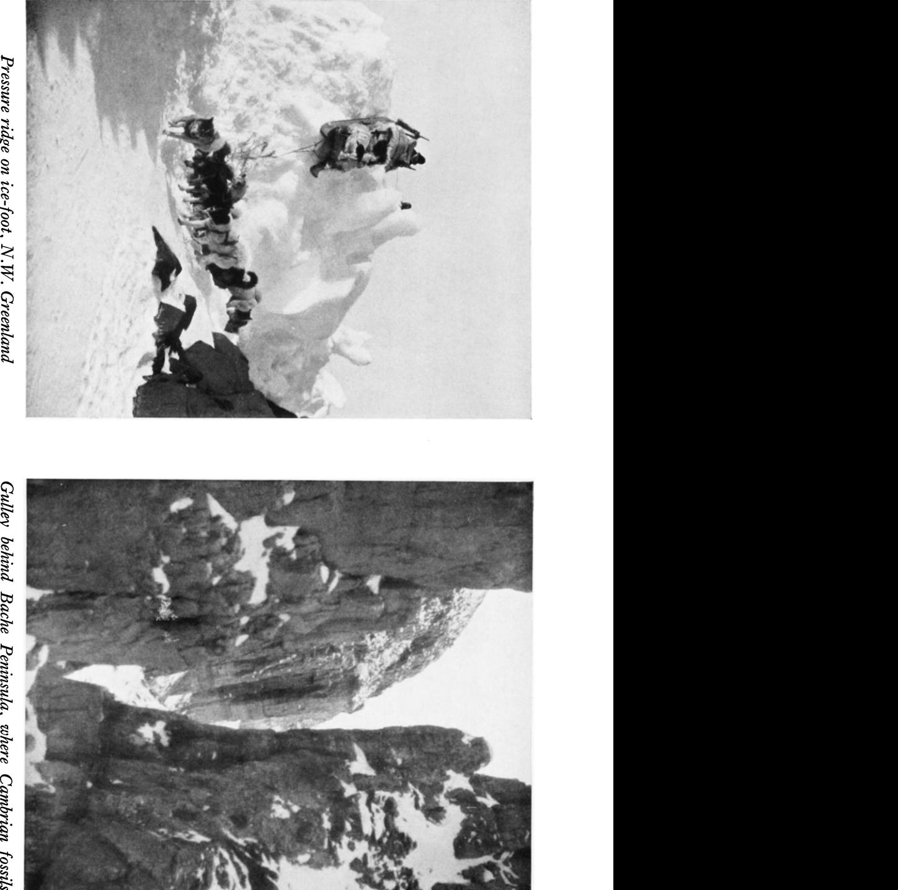
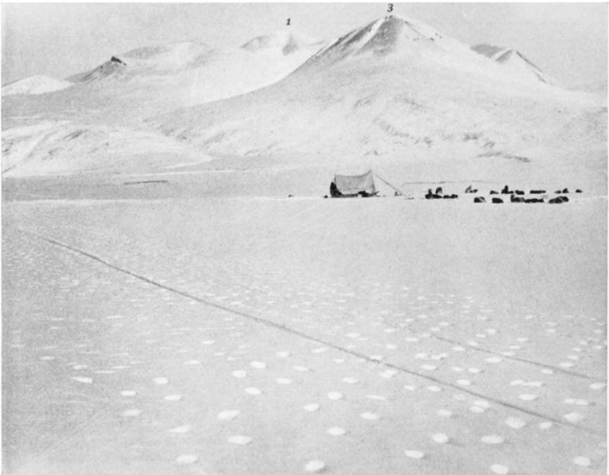
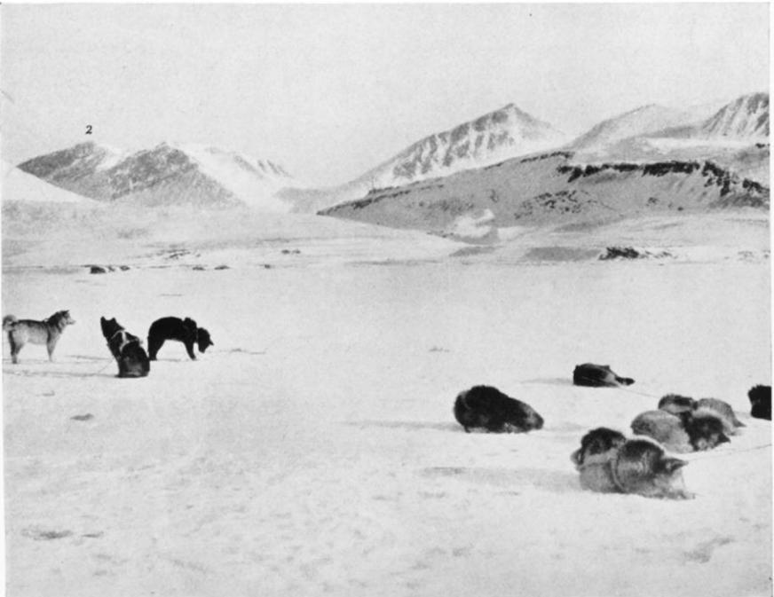
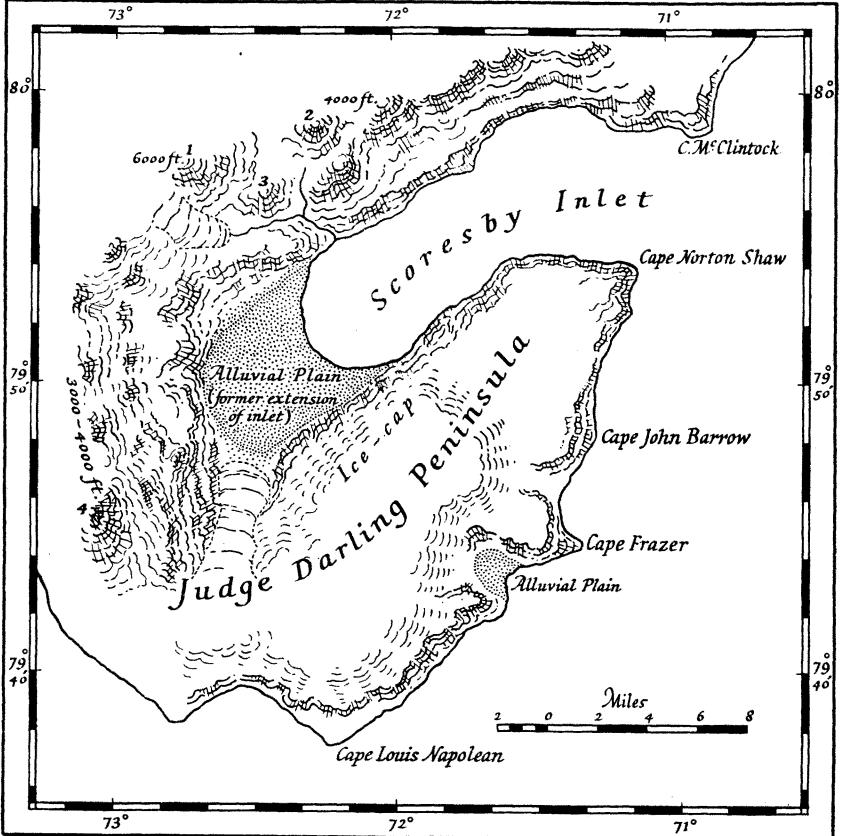
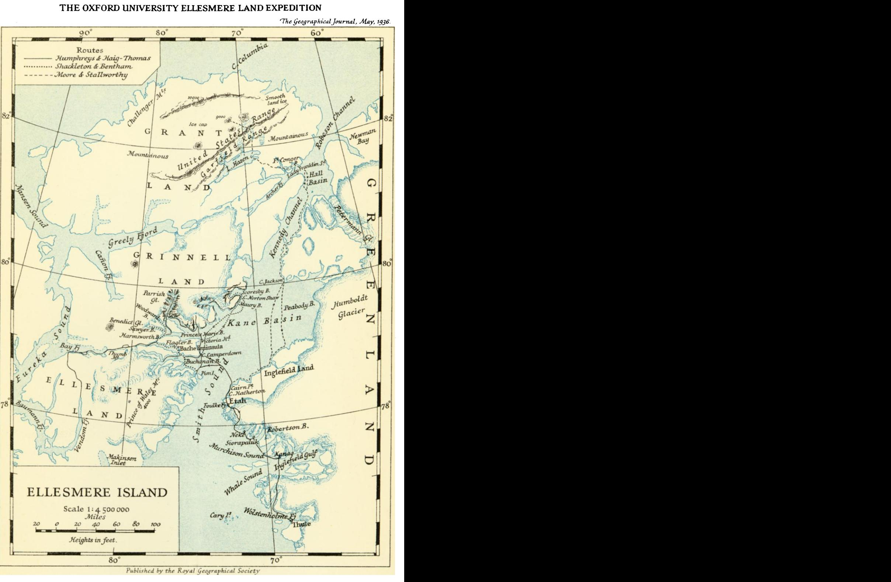

The Scoresby Bay Journey Author(s): Edward Shackleton Source: The Geographical Journal, Vol. 87, No. 5 (May, 1936), pp. 410-419 Published by: The Royal Geographical Society Stable URL: https://www.jstor.org/stable/1785642 Accessed: 08-09-2026 22:59 UTC

JSTOR is a not-for-profit service that helps scholars, researchers, and students discover, use, and build upon a wide range of content in a trusted digital archive. We use information technology and tools to increase productivity and facilitate new forms of scholarship. For more information about JSTOR, please contact support@jstor.org.

Your use of the JSTOR archive indicates your acceptance of the Terms & Conditions of Use, available at https://about.jstor.org/terms

The Royal Geographical Society is collaborating with JSTOR to digitize, preserve and extend access to The Geographical Journal

 unexplored Ellesmere Island at five points, we had been able to make valuable collections and we had gained an enormous amount of experience which some of us hope to be able to use on future expeditions. unexplored Ellesmere Island at five points, we had been able to make valuable collections and we had gained an enormous amount of experience which some of us hope to be able to use on future expeditions.

# II. THE SCORESBY BAY JOURNEY

### EDWARD SHACKLETON

 O N April 4 Bentham and I left Etah en route for the main pemmican cache, a few miles north of Cairn Point. This meant a journey of about 20 miles, the first part of which was across rocky country. The first two parties, with whom we hoped to meet, had "packed" their loads up the hill behind the house, but our Eskimo chose a different route in order to avoid this laborious process, and so on a windy but sunny afternoon five sledges headed seaward. Four of these were driven by Eskimo, and the fifth by Bentham and myself, with sixteen dogs in our team. The two older and more experienced natives, Porsman and Ahnowka, were to accompany us on the whole trip, and the two younger men were to act as a support party, travelling with us until their pemmican loads should be used up. Porsman was a famous traveller among the Smith Sound Eskimo, for he had been one of the picked men who had travelled with the late Dr. Knud Rasmussen on his sledge journey round North Green land, a starvation trip of which he had vivid memories. With comparatively light loads and a strong following wind we headed for Sunrise Point, but after 2 or 3 miles we met our first check, open water which compelled us to take to the ice-foot. It took us the best part of an hour to chop a way through the hummocks, but after this our progress was rapid until we reached a bay from which a long snow slope stretched steeply up into the hills of the interior. A tearing wind with high drift was sweeping downhill, and our dogs were even more reluctant than we to face the stinging clouds of snow. In patches too the ground was bare, and the sledges frequently stuck. Finally, by dint of much shouting and the use of the long whips, we topped the slope and drove along the comparatively level uplands. The wind soon abated, and we made fairly good progress over the divide and down to the sea ice on the other side, where we made camp. From this point we had a good trail, and although in places we had to take to the ice-foot owing to open water, we made steady progress towards the main pack lying north of Cairn Point. The nearer we approached it the colder it became, and as we crossed Refuge Harbour, MacMillan's old winter quarters, an icy wind met us. At this point the sledge trails led to open water, where some ice had apparently gone out after the other parties had passed, and with a certain amount of difficulty, owing to the very low tide, we dragged the sledges up on to the ice-foot, 20 feet above the level of the sea. We finally drove into camp with our faces frost-bitten, only to find the others had already left that day. The following day was taken up with polishing the steel sledge runners, which were badly scored from the land crossing, collecting the cases of Bovril dog-pemmican, and finally distributing the loads, and lashing up. This took a good deal of time, and it was after sunset that we headed out to sea, north-west along the trail made by Humphreys and

4IO

 his party the previous day. Our previous two days' travel had brought us into a different climate. When we set out from Etah the temperatures were a good deal higher than during the previous months of February and March, but after we had left the open water and taken our course over the sea-ice, we seemed to drive back into the coldest part of the year. It was by now light enough to travel through the night, but the sun was not permanently above the horizon yet, and during our first night's journey we encountered between 6o and 70 degrees of frost. However occasional patches of rough ice, which entailed a certain amount of work, kept us warm and as the ice conditions improved we kept up a rate of travel which enabled us to run behind the sledges whenever we felt cold. We stopped to boil some tea at Humphreys' first camp on the floe, but as we were very anxious to catch him up, we pushed on another two or three hours' distance, camping in the light of the rising sun.

 We continued after an early start, and another twelve hours brought us to the police dep6t at Fram Haven. To reach this we had to travel through some very rough ice, with deep snow between the piled-up floes, but we were fortunate in having a trail ready made for us. Indeed it was largely due to the fact that the first party had pioneered a way for us that we were able to make such good time across Smith Sound. The value of this was all the more apparent when the following morning Sakeus, our youngest Eskimo, com plained of a sharp pain in one of his eyes, as if it were full of iron filings. This description so exactly fitted the symptoms of snow-blindness that we imme diately concluded that it was from this that he was suffering. An examination however soon showed that it was indeed an iron filing that was causing the trouble, a result no doubt of his work polishing the steel runners of his sledge the day we set out from Greenland. There was no choice but to push on as quickly as possible in the hopes of catching Humphreys, and to this end we decided to make a forced march right through to the old police detachment at the entrance of Flagler Fjord. With good ice conditions this would mean a journey of 35 miles, but under present circumstances we should have to make a wide detour of over 50 miles, much of it through heavy ice. We collected from the dep6t various articles of food and equipment that would be of use to us and set out about ten in the evening. We reached Cape Albert about six the following morning, and cached our reserves of dog-feed and provisions. A little farther on Sakeus was in such pain that it was clearly impossible for him to continue to drive his sledge across the glaring snow and ice. His eyes were bandaged and Porsman took him on his sledge, with orders to push on as quickly as possible, while Bentham drove our sledge and I managed one of the Eskimo dog teams. I think that was one of the longest days of the whole trip. Later on we became accustomed to sleeping at twenty-four hour intervals, but there was not one of us on this occasion who did not, as the trail improved, fall asleep on his sledge. We finally drove into the former police outpost about three in the afternoon, and there we were relieved to find Dr. Humphreys, who immediately performed a successful minor operation, after anaesthetising the injured eye.

 Humphreys and Haig-Thomas left for the north on April II and on the following day Bentham started on a collecting trip to the seaward end of the peninsula. On the I3th, accompanied by Porsman and Sakeus with two

 sledges, I drove up Flagler Fjord to reconnoitre a way across the peninsula with a view to examining the glaciers that discharge into Princess Marie Bay. We had excellent going up the fjord, and thanks to Sakeus who knew the surrounding country very well we had no difficulty in picking a very easy route for our lightly loaded sledges. The peninsula at this point narrowed to a neck not more than a mile and a half wide, though the existing maps gave it a greater width than this. After stopping to make tea we were soon across, and the sun had set and risen again by the time we had topped the height of the pass, only 700 feet above the level of the sea ice. A steep descent over rocks meant some care to prevent the sledge getting out of control and over running the dogs. Sakeus acting as a brake to the sledge, with myself in front whipping the dogs back, managed all right, but Porsman who followed, shot past at about 30 miles an hour, shouting at the top of his voice, finally ending up in a hopeless tangle, with the dogs underneath the sledge. The next day we set out to examine the Sven Hedin Glacier, which discharged into Woodward Bay. We were soon climbing the terminal moraine across which ran several crevasses, but at a height of 40 feet we found that we were only about half-way up the face of the glacier. So much for our hopes of an easy ascent. For the most part it was at least 60 feet high and scored by huge crevasses and fissures visible along the topmost edge, except in places where snow softened the outline. The talus in front of the glacier, the badly crevassed condition of the terminal moraine up which we had climbed, and the convexity and sometimes vertical angle of the glacier snout, all indicated that the glacier was advancing. It was necessary to return at once, so that Bentham could benefit by the information we had gleaned in carrying out his all-important geological work. The long hours of the return journey were more of a test of the dogs than their drivers, but we were so lightly loaded that when we again descended to the smooth ice of Flagler Fjord they could gallop along at a good pace. We eventually arrived back on the afternoon of the I5th, after a twenty-four hour day, during which we had covered about 70 miles. Bentham had already returned from his geological trip, and had found a number of very valuable Cambrian fossils. We spent the next few days hunting seal, but for some reason they had disappeared, and after I had taken a series of observations for latitude and longitude, we realized we should have to leave for our pemmican cache in order to feed our hungry dogs. Thence we intended to push northward to Scoresby Bay. On April 25 therefore we set out for Cape Albert, at the eastern end of Bache Peninsula, and having emptied our depot of provisions we headed out into Kane Basin. For the first two days our progress over the sea-ice was slow, since our dogs were in very bad shape and ice conditions were unfavourable. However by climbing the bigger pressure ridges, some of which had been piled as high as 25 feet, the Eskimo had been able to pick out the best route, and so we managed to steer clear of any really rough ice. After three days on the trail we had covered 80 miles, but our fourth day was destined to give us a harder task. After a couple of hours' travel we found the Eskimo had halted at the foot of some huge pressure ridges, and they greeted us with the information that there was bad ice ahead. It certainly was bad. The next hour we scarcely made a mile's progress; although the temperature was below zero we threw off all our extra clothing, and laboured to find a way

412

 through the chaotic floes. Axes were in continuous use, for the sledges and dog-traces were continually catching up on the ice pinnacles, and whenever a sledge topped a particularly high ridge of ice it would race down the other side and bury the runners in ice and snow, which we then had to chop free. But the deep snow that lay in the hollows was the worst feature. Quite sud denly the sledge runners would sink out of sight and then the dogs had to struggle along on their bellies, and we never knew whether the next step would be on a sharp piece of ice, or whether we should find ourselves up to our thighs in the snow. After a time however conditions improved, and we crossed a huge palaeocrystic floe, tremendously thick and worn and weathered during countless years, into an undulating country of miniature hills and valleys. On this the snow was packed much harder, and for several hours we made good progress, driving up and down hill until we were nearly half-way across Dobbin Bay. Then a few more patches of rough ice and we swung due west on to a wonderful smooth stretch of ice. Here under the shelter of a huge pressure ridge, which marked the limit of the rough ice, we made our camp, after being on the trail for eleven hours.

 The following day we set out over excellent smooth ice, and made fast time in the direction of Cape Louis Napoleon. After a couple of hours' travel two of the Eskimo stopped by some seal holes in the hopes of a shot, but they were out of luck. Towards evening, as we neared Hayes Point, patches of rough ice began to occur and we were finally stopped by a barrier even more impene trable than the previous day's ice. We had no choice but to force our way through to the mainland, about 3 miles distant, in the hopes of finding a good ice-foot. This possibility the natives regarded rather dubiously. For the next hour and a half there was such a pounding and jarring of the sledges that it seemed an absolute miracle that they were not smashed beyond repair. Although the temperature was below zero, for it was about midnight, we were all drenched with sweat, and by the time we reached land our beards, eye brows, eye-lashes, and hair were white with frost. The dogs were com pletely worn out, but we had now reached a broad highway of smooth ice and we pushed on for a couple of hours, finally camping just south of Hayes Point. By chance we had struck a fossiliferous area, and Bentham was able to make a good collection of Silurian trilobites, gastropods, and brachiopods. The ice-foot was wonderfully smooth by Hayes Point, where we had halted, but already there were warnings of trouble ahead, if we had been able to read the signs, for some huge boulder-shaped pieces of ice had been piled up here and there on the seaward edge of the ice-foot, an indication of tremendous pressure the previous open season. The following day we pushed on as rapidly as we could, hoping that the excellent ice-foot would continue far to the north, since the sea-ice was impracticable; for with our big dog-teams, so essential for the conditions of travel amid the gigantic floes of the Polar pack, we could not hope for anything like the range of travel that belongs to a party sledging over the smooth surface of the ice-cap. So far we had seen no seal, and our stock of pemmican was diminishing rapidly. As we made our way along the shore of the Darling Peninsula, we reached a bay of curious formation. A io-foot bank of gravel marked the limit of a remarkable stretch of smooth shingly ground, with occasional shallow patches of soft snow. Inland a glacier

 was visible and on either side the hills sloped gently down to the plain, a striking contrast to the usual steep Iooo-foot cliffs which marked the coast line elsewhere. Accidentally we had hit on an ideal landing ground for aeroplanes, which might perhaps in the not so far distant future be used at all seasons of the year. The condition of the snow showed too that the locality was free from winds. Temporarily therefore we decided to christen it Aero drome Bay. From this point on the ice-foot deteriorated. In places we had to take to the hummocks, and when later we were able to regain it, it was covered with dirt and stones from the hillside, which was very hard on our steel-shod runners. The sea-ice too was covered in rock detritus, and a huge wall of floes bordered the ice-foot. So we continued until just south of Cape Fraser we found our way was barred by an indescribable chaos of piled-up floes. The ice foot completely disappeared beneath the huge blocks which reached 30 to 40 feet from the sea up the hillside. I had never imagined anything so devastating as the power which could produce such an effect. Millions of tons of ice had been forced out of the sea by pressure so enormous that nothing could have withstood it; and yet this was the sea through which Peary and others forced their ships on their way to northern latitudes. After reconnoitring along the hillside we soon saw that there was nothing for it but to take to the sea-ice again, rough though it might be. We had to chop a way over the rampart of jumbled floes that had lined the ice-foot for the last few miles, and it took us over half an hour to lower the sledges to the level of the sea-ice. We finally made camp about 3 miles south of Scoresby Bay, close to an outcrop of rock which had attracted Bentham's interest as a geologist. This locality exceeded all his expectations, being highly fossiliferous, and since Scoresby Bay was unexplored territory and immensely interesting from a geological standpoint, we decided to devote some days to a thorough investigation of the neighbour hood. Our most immediate need was to rest the dogs, and so we turned in for the night with the feeling that we should be able to sleep our fill. We were to have a most rude awakening. During the night a blizzard rose, and we heard the howl of the wind and the snow rattling like small shot against the walls of the tent, but we were too comfortable to be disturbed by this. Suddenly however we were all wide awake. The blizzard had stopped, but a heavy roar filled the air. We could feel the floe on which we were camped, about 50 yards from the ice-foot, vibrating and cracking. The tent shook as if in a gale, and above all we could hear the tremendous crash of rending ice. We were out of our sleeping-bags in a second and undoing the tent-flap. We all had vivid ideas of some catastrophe. Bentham and I imagined the ice breaking loose as a result of the night's blizzard, and being smashed to pieces between heavy floes and the shore ice. The Eskimo were nearer the mark, for they visualized the whole ice-foot, with its vast load of pressure-ice, crashing down on us. For tunately it was not quite as bad as this for, as we soon saw, the main ice-foot was intact. Nevertheless a huge section of ice, weighing thousands of tons at least, had crashed on to the floe, shivering it in all directions. Several large cracks ran from the shattered area, and some of the dogs had broken loose in the terror of the moment. We were soon back in our sleeping-bags.

 On April 29 Bentham began a detailed examination of the rocks in the neighbourhood, as far as Cape Norton Shaw, the southern cape of Scoresby

414

 Bay, while I set out with one of the Eskimo to reconnoitre Scoresby Bay. (This had previously been passed by other explorers bound for higher latitudes, and Humphreys had thought that there was a good chance of making some interesting discoveries. Bentham's chief interest was to find the junction between the Silurian and the Cape Ransom beds, which according to Fielden extend north from Scoresby Bay.) Travelling with a light sledge and a big dog-team, we had soon rounded Cape Norton Shaw and were heading up the bay along the ice-foot. After travelling about 8 or 9 miles we noticed the bay was tending to bear more and more in a southerly direction. We soon realized that it had a very different shape and extent from that shown on the map, being more in the nature of an inlet than a bay; and as we swung farther and farther south, we lost sight of the seaward end of the bay, and high mountains came into view on its western side. Just as we swung round the last bend on the ice-foot, into sight of the end of the bay, the whole dazzling range of the Victoria and Albert Mountains sprang into view. Their foothills rose straight from the sea-ice and the highest peaks were not more than 7 or 8 miles inland, although shown on the map as at least 20 miles into the interior. This was because the only view of them seen by Nares, who had placed them on the map, was from the deck of his ship some distance out to sea. One mountain was particularly magnificent, rising steeply to a height of over 5000 feet, as near as we could judge, and entirely encircled by ice at a height of about 2000 feet, flowing from the ice-cap. Some small glaciers too could be observed, and at the southern end of the inlet was a low, gently rising plain, leading up to a divide which presumably separated Scoresby Bay from Dobbin Bay. A solitary mountain guarded the divide. We drove on up the inlet and about 5 miles from its head were able to take to the sea-ice, which was by now free from the old floes which were jammed in the mouth. We were finally able to distinguish the low-lying southern shore-line from the sea-ice, and at this point we stopped, as I intended to return to camp the same day. I took a few photographs and some compass-bearings, but it was too cold to spend long at it. A little wind was whipping the snow off the ground, and so we decided to return to a warmer neighbourhood than this sunless valley. In the meanwhile Bentham had spent a profitable day collecting, although somewhat hindered by the previous night's storm, which had covered the rocks with a thin layer of snow. We were both rather excited by the discoveries in Scoresby Bay, particularly the mountain range which, according to the map, should have been many miles inland. There was no doubt that this must have been the range seen by the Nares Expedition, and subsequent investigation supported this conclusion. If there is a chain of mountains in the interior of Grinnell Land, it must have been far beyond the range of vision of any of our predeces sors. So we made detailed plans for completing our work at Scoresby Inlet, and it was arranged that Bentham should move camp to the head of the inlet, while I was to spend one night at Cape Norton Shaw, set up the wireless so as to get time-signals, and then take some observations for latitude and longitude. As soon as this wyas finished I was to join Bentham, and we then hoped to make an attempt on the highest mountain in the Victoria and Albert Range, in order to get a good view into the unknown interior of Grinnell Land.

In the early hours of May i we drove to Cape Norton Shaw and there,

 after building a snow iglu, Bentham took two Eskimo and continued on his way. The Stratton S.W. Receiver was soon set up, and I was able to get some good time-signals for correcting times of observations on the sun. Even more interesting was the fact that though I had only a two-valve set, I easily heard news bulletins from the Empire Short-Wave Station at Daventry, and later from American Stations, notably Pittsburgh, Philadelphia, Sche nectady, and Cincinnati. Unfortunately the following day was too cold to hope for anything but an extremely hurried series of observations, which would be no improvement on existing data, and so I had to abandon the attempt for this day at any rate, and as I was not feeling at all well, I at once drove to Bentham's camp.

 In the meanwhile Bentham had set off to climb one of the foothills below the high mountain which I had particularly noted on my first trip up Scoresby Inlet. He started off up a valley, but found the going very difficult. There was over 2 feet of soft snow into which he sank at every step, and the hillside was even worse. However he plodded on for four hours, by which time he realized he would never reach the summit without a sleep. He then turned to retrace his steps, but found the descent even more exhausting. Unfor tunately he had not anticipated these conditions and so was not wearing snow shoes. The conditions were particularly trying since there was a thin wind crust on the snow, and it was of such a nature that it would bear the weight of the foot at first, but as soon as the other foot was lifted down went the first into 2 feet of snow. To add to his troubles he felt an attack of snow-blindness coming on, and it was imperative he should get back quickly, in case it developed and it became impossible to travel. However by keeping his eyes half closed and resting at short intervals, he managed to struggle safely back into camp. This preliminary excursion showed that in the circumstances the attempt to climb the main peak would take a considerable time, and could only be accomplished if the weather held out for at least thirty-six hours. There was likely to be deep snow right up to the summit and in addition it would be necessary to cross a tongue of the ice-cap, which was almost certain to be riddled with concealed crevasses. The following day there was dense cloud and any attempt on the mountain was impossible. In addition I was unfortunately too ill to get up, the trouble evidently being some kind of poisoning. Bentham spent the day travelling along the north-west side of the Inlet, collecting fossils and looking for the junction between the Silurian and the Cape Ransom beds, but his discoveries were of a negative nature, for the whole of Scoresby Bay was Silurian as far north as Cape McLintock.

 Our Eskimo had been completely unsuccessful in their hunt for bear and seal, and our total bag up to date consisted of one Arctic hare. There was only pemmican enough for three dog-feeds left out at the point, and the dogs had not been fed for two days. The wonderfully fine weather of April, clear and cold, had broken: most days the sky was overcast and a south wind threatened more blizzards. We had in front of us a journey which on the outward march had taken us seven days. It was impossible to delay any longer our return to Bache, where we might hope to obtain seal, and so save our dogs from starva tion. Our sledges were now much lighter, and thanks to our experience on the outward march we were able to avoid the worst of the bad ice. By the time

This content downloaded from 132.174.250.38 on Tue, 08 Sep 2026 22:59:49 UTC All use subject to https://about.jstor.org/terms

N.W. side of Scoresby Bay: Peak I approximately 6000 feet

N.W. side of Scoresby Bay

 we reached Cape Hawks, south of Dobbin Bay, we had finished all our dog feed, but on May 7 and 8 we made a forced march to Cape Albert, covering 50 miles without a sleep, and so finished the last part of our journey, driving up to the hut at Bache Peninsula in glorious weather on May 9. The Eskimo immediately went out hunting and brought in four seal for the dogs, which were by now ravenous.

We now decided to spend some days completing work which we had been

 unable to do during our previous visit to Bache Peninsula. Bentham crossed over into Princess Marie Bay and spent five days collecting in that neighbour hood, while I travelled with a native to Alexandras Fjord to search for ancient Eskimo remains. This however turned out to be very difficult owing to the deep snow; but Bentham had a successful trip and we finally set out for Etah on May i8. We had to abandon one of the sledges which had been smashed beyond repair, and so it was with only three sledges and with a diminished number of dogs that we finally set out for Etah. There were already signs of a thaw. The ice which Bentham had had to cross at the mouth of Flagler Fjord, on his way back from Princess Marie Bay, had been very rotten. In fact there was a certain amount of lead-jumping to be done before his party 27

 could get through, and the Eskimo were now eager to return home because they feared the ice in Smith Sound might break up at any moment; this would necessitate a long detour to the north round the edge of the open water. During our first day's march we covered at least 40 miles and were over fifteen hours on the trail. This took us far out into the Sound, and when we broke camp in the early morning of the 20oth the weather was very threatening, especially towards the south, the quarter from which we could expect a blizzard. However we could see the Greenland coast and we pushed on as rapidly as possible, as we had no wish to be caught in a blizzard in the middle of Smith Sound at this time of the year. The next time we might see the coast would perhaps be from a drifting floe! After a short distance one of the Eskimo shot a seal, and the dogs being very hungry we stopped to feed. Meanwhile it came on to snow fairly hard and we had no choice but to wait for the weather to clear, since although we could have steered a compass course, it might have landed us in open water, if the ice had gone out close to the Greenland side. However after about an hour the snow ceased and a wind cleared the air enough for us to distinguish land. But this was only a short respite. About 2.30 p.m. a strong wind got up, whirling the newly fallen snow into clouds. A little later the land was hidden from sight and in a flash the sledges disappeared. The wind was now blowing half a gale and rising every moment. Immediately the sledges disappeared from sight Ahnowka and Bentham who were leading, stopped and we were soon together again. There was no choice but to make camp at once, before the full force of the rising blizzard struck us. This was no easy matter, for the tent behaved like a wild thing and it took five of us all our time to get it up. Indeed it is doubtful if a quarter of an hour later we could have accomplished it. Already visibility was reduced to a few yards by swirling clouds of snow, and the dogs lay covered in drifts which had formed almost instantly. We were soon safe in the tent and there we were able to appreciate the full force of the blizzard almost better than outside, for the canvas was cracking and banging as if a bombardment was going on. Every now and then a more violent explosion startled us into the belief that the tent would be ripped to shreds, and once we thought we might have to take the poles out and let the tent down so that the snow could drift over it. At the leeward end there accumulated a drift of snow half the height of the tent, and this pressed heavily inward; but the tent, a standard model made by Messrs. Black & Co., of Greenock, stood every strain. So we spent the next thirty-six hours, and it was not until the evening of the next day that we were able to set out. We then discovered that we were encamped within half a mile of open water! However it was just as well for our peace of mind that we had not known this before. Whatever happened we felt we were safe with a south wind, which would only tend to pack the ice more closely.

 Although our sledges were buried deep in drifts and had to be dug out, the ice itself was in perfect condition, for the wind had swept all the loose snow off the surface and what remained was packed hard. So we made excellent time and soon reached land close to Cairn Point. Near the shore the ice was very thin and rotten, and we had to take to the ice-foot. In one place we had to lower the sledges on to floating ice-pans and ferry them round a-point where the ice-foot had collapsed, as we discovered afterwards, beneath one of the

4I8

 sledges of Humphreys' party, crushing six of their dogs to death. After this we followed practically the same trail as on the outward journey and camped in Hatherton Bay on the afternoon of May 22, after about sixteen hours on the trail. We were now only a short distance from Etah and the land-crossing was our sole remaining obstacle. Although this had proved one of the most difficult parts of the whole journey on the outward march it turned out to be much easier now with our lighter sledges. In addition a good deal more snow had fallen, and many of the rocks which had caused us trouble before had disappeared. sledges of Humphreys' party, crushing six of their dogs to death. After this we followed practically the same trail as on the outward journey and camped in Hatherton Bay on the afternoon of May 22, after about sixteen hours on the trail. We were now only a short distance from Etah and the land-crossing was our sole remaining obstacle. Although this had proved one of the most difficult parts of the whole journey on the outward march it turned out to be much easier now with our lighter sledges. In addition a good deal more snow had fallen, and many of the rocks which had caused us trouble before had disappeared.

 So we arrived back at Etah in the early hours of the 24th, after a journey of 8oo miles. Our Eskimo were so keen to reach their sealing grounds in the south that they decided to leave that same day with Humphreys' natives who had arrived back the day before us. So after paying them off and giving them all the tea, coffee, flour, and other food they could carry, we finally bid them a sad goodbye. Porsman in particular we were sorry to part with, for although they had all served us faithfully we had an especial affection for him as for an old friend. It was his energy, endurance, and cheerfulness, and that of his companions, that brought us such small success as we attained. So we arrived back at Etah in the early hours of the 24th, after a journey of 8oo miles. Our Eskimo were so keen to reach their sealing grounds in the south that they decided to leave that same day with Humphreys' natives who had arrived back the day before us. So after paying them off and giving them all the tea, coffee, flour, and other food they could carry, we finally bid them a sad goodbye. Porsman in particular we were sorry to part with, for although they had all served us faithfully we had an especial affection for him as for an old friend. It was his energy, endurance, and cheerfulness, and that of his companions, that brought us such small success as we attained.

# III. THE SLEDGE JOURNEY TO GRANT LAND

#### A. W. MOORE

 AT noon on 3 April I935 the Grant Land party drove northwards from Etah in a gale. The party consisted of Sergt. H. W. Stallworthy, R.C.M.P., two Eskimo (Nukapinguaq and Inuatuk), and myself. There were also two Eskimo sledges in support carrying dog food; these would travel with us as far as Cape Calhoun, which lies north of the Humboldt glacier at the entrance to Kennedy Channel. Our point of departure was the summit of the steep ravine behind Etah, where on the previous day all the stores and equipment had been "packed" by us, thus saving much time.

 After travelling for twelve hours we drove up to the large pemmican dep6t established during the previous autumn. It was very cold with a biting north wind blowing and the thermometer registered -32? F. As anticipated, we found Dr. Humphreys' party encamped here. They had started a day earlier than us, and we had followed their route, thus being spared hours of hard work consisting of chopping ways for the sledges through huge hummocks of pressure ice which had piled up on the shore. On our arrival the camp was in deep sleep, and after pitching our tent on the sea-ice we too were soon in our sleeping-bags enjoying biscuits and steaming hot coffee. The next day we spent in allocating the loads for our sledges, and in filing down the steel runners which had suffered badly on the rocks during the overland crossing from Etah to the sea-ice. Humphreys' party was the first to leave the dep6t, setting out the next morning across Smith Sound for Ellesmere Land. We watched the sledges until they disappeared like tiny black specks over the white horizon. That evening we drove northwards. Our sledges were heavily

419

## THE OXFORD UNIVERSITY ELLESMERE LAND EXPEDITION

