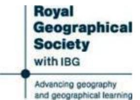

Oxford University Ellesmere Land Expedition: Discussion Author(s): Percy Cox, H. E., Colonel Vanier and H. R. Mill Source: The Geographical Journal, Vol. 87, No. 5 (May, 1936), pp. 441-443 Published by: The Royal Geographical Society Stable URL: https://www.jstor.org/stable/1785644 Accessed: 08-09-2026 22:59 UTC

JSTOR is a not-for-profit service that helps scholars, researchers, and students discover, use, and build upon a wide range of content in a trusted digital archive. We use information technology and tools to increase productivity and facilitate new forms of scholarship. For more information about JSTOR, please contact support@jstor.org.

Your use of the JSTOR archive indicates your acceptance of the Terms & Conditions of Use, available at https://about.jstor.org/terms

The Royal Geographical Society is collaborating with JSTOR to digitize, preserve and extend access to The Geographical Journal

 Bay, and head of Foulke Fjord. Mr. D. Haig-Thomas assisted with some collections at Cape Hatherton; while plants were also collected at Disko and Jakobshavn in August (Haig-Thomas) and September (Humphreys). Altogether about three hundred numbers of well-collected and dried specimens are avail able for study, a list of which will be prepared in due course.

 A. W. Moore made a small collection of marine animals by dredging at depths between 20 feet and 70 feet in Foulke Fjord, Etah, in July 1935. These specimens are deposited in the British Museum (Natural History). They include mainly Crustacea, Echinoderms, small fish, and a few Mollusca. A report will be issued later.

## DISCUSSION

 Before the paper the PRESIDENT (Major-General Sir PERCY Cox) said: We have a full evening and so I do not propose to keep you long with my opening remarks. It is an honour and pleasure to us to have the Danish Minister here, and also Colonel Vanier, representing the High Commissioner for Canada. You will realize as the evening goes on how grateful the lecturers are for the help and cooperation they received from those two governments.

 The title of the lecture is "The Oxford University Ellesmere Land Expedi tion." The leader was Dr. Noel Humphreys and the organizer Mr. Edward Shackleton. Dr. Humphreys will lead off and be followed by Mr. Shackleton and the other members of the Expedition.

 As regards Dr. Humphreys you will doubtless remember him for his two papers upon the work he did on Ruwenzori. He was awarded the Murchison Grant two years ago for his work there. Edward Shackleton I need hardly introduce. We have the statue of his father close to us on the outer wall of this hall. He was the organizer of the expedition in consultation with Mr. Charles Elton, and both he and his comrades will, I hope, each have a few words to say about the part which they severally played in the expedition. They decided to split up into three parties in order to take full advantage of their opportunities. They have some splendid slides to show us.

 Dr. Noel Humphreys, Mr. Edward Shackleton, and other members of the expe dition then contributed to the record printed above, and a discussion followed.

 The PRESIDENT: We have the great pleasure to-night of the presence of H.E. The Danish Minister: and I want to ask him if he will say a few words.

 H.E. THE DANISH MINISTER: It has given me the greatest pleasure to be present to-night to listen to the very interesting remarks by Dr. Noel Humphreys, Mr. Edward Shackleton, and their brave comrades. I have been especially touched by the very kind words that have been uttered concerning our coloniza tion of Greenland and the help extended to the expedition by the Danish Government. It has become the tradition under the auspices of the Royal Geographical Society that Great Britain and Denmark should work hand in hand in Arctic exploration, and it is my hope that this cooperation will continue for many years to come.

The PRESIDENT: Colonel Vanier, would you say a few words ?

 Colonel VANIER: In the first place, I should like to bring you a message of regret from the High Commissioner for Canada who is unable to be present here this evening. He would have wished to welcome in person the members of this expedition back from their successful work in Arctic Canada.

 I had the good fortune to be at St. Katherine's Dock when the Signalhorn left, and I almost jumped aboard. I believe that if there had not been a physical

## 442 OXFORD UNIVERSITY ELLESMERE LAND EXPEDITION: DISCUSSION

 disability to prevent it I might have been tempted to leave my work and my family. It gives me therefore particular pleasure to welcome back from that expedition Dr. Humphreys, Mr. Shackleton and the other members. They have spoken of the debt that they owe to Canada: I should like to say that if a debt is owed at all it is by Canada to them; and I should like to pay to them a tribute of gratitude and of admiration.

 You will have noticed that the Danish and the Canadian Governments are always willing to cooperate in matters of exploration, even though at times they may be rivals in the field of live-stock or its products. If the expedition had not made use of pemmican I should not have dared, because it would have been indiscreet, to ask Dr. Humphreys and Mr. Shackleton whether they had carried Danish or Canadian bacon!

 I have learned a great deal to-night. I have learned that Ellesmere Island is, or might be, an asylum for retired policemen! I have also heard of a most inter esting game-burnt-cork patience-that I am going to try to teach my children. But there is one thing that the members of this expedition did not tell us, and it is something that I happen to know: that they used extraordinary self-restraint when dealing with the musk-ox which you saw on the screen. They were sporting enough never to shoot one of them, although at times they must have been sorely tempted to do so because the dogs were hungry.

 My last word is this: when they go back to Ellesmere Land-and they are going back, because all explorers are either out on an expedition or speaking about it for a very short time and then preparing for another expedition-when they go back I am sure that they will have the whole-hearted support of the Canadian Government, and we shall see whether it is not possible to obtain permission to shoot a few musk-ox.

The PRESIDENT: Dr. Mill, we should like to hear you for a few minutes.

 Dr. H. R. MILL: Of the many charming and delightful evening meetings which take place in this hall I think you will agree with me that none has given rise to greater pleasure or more admiration for the speakers than this to-night. We have grown accustomed to bright descriptions of their achievements by the young men from the Universities of Oxford and Cambridge, and to-night seems to suggest that perhaps, of the two, the dark blue team is the more light-hearted. I do not think I have ever heard in all the many meetings of this Society so much good nature in the description of hard experiences in a difficult country and such an amount of mirth in the audience at pictures, which have rarely been excelled in beauty or aptness.

 I will not praise the individual speakers, though I must express gratification at seeing my young friend Shackleton following so happily in the footsteps of my old friend, his father. But there were feelings in my mind, going back to the memory of earlier expeditions to that wonderful Ellesmere Land, which we saw to-night as a place of flowers, where snow-buntings went for no other purpose but to fly about and enjoy themselves. In the old days the stories from Ellesmere Land were of a grimmer kind. I remember well as a boy reading of the diffi culties that beset the last British Naval Arctic Expedition under Captain Nares in the Alert and the Discovery; and just fifty years ago this week I heard Lieutenant A. W. Greely describe the achievements of the American party during the three hard winters they spent at their base at Fort Conger and on their return journey which only a few survived.

 It is a curious thought that Greely lived long enough to hear about this latest expedition to Fort Conger, for he only died last month in his ninety-second year -a rare age indeed for Arctic explorers. But from what we have heard of the proceedings of the Oxford University Expedition I look forward confidently to

 those young men going back and back again until they finish their work and perhaps reach an age as great as that of Greely himself.

 The PRESIDENT: There are two expressions of regret that I wish to convey to you. The first is that Lady Shackleton and her daughter have not been able to come to-night, Lady Shackleton being unfortunately not well enough. The second is that Sergeant Stallworthy is not here. As you have heard, the members of the expedition have all paid great tribute to his fine qualities and the help they received from him during the expedition. As to the expedition itself, the party had every sort of ill-luck in the way of weather and ice conditions to start with. But in spite of being kept the whole winter at Etah, whereas they had hoped to have been on the Bache Peninsula, they accomplished really valuable work, locating a new range of mountains between United States Range and the Arctic Ocean. I very much hope that they may find it possible to organize another attack on it, with the knowledge that they will have a fine piece of discovery to their credit, if they succeed.

 I should like, in conclusion, to thank all the speakers who have been good enough to come to-night, and to ask you all to join me in thanking members of the expedition for a most interesting and instructive evening.