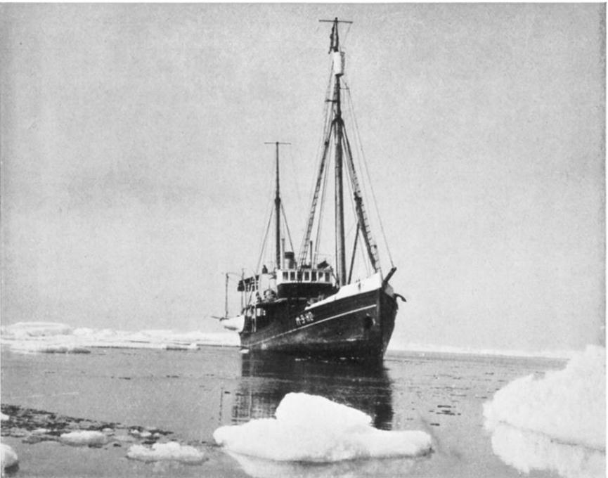
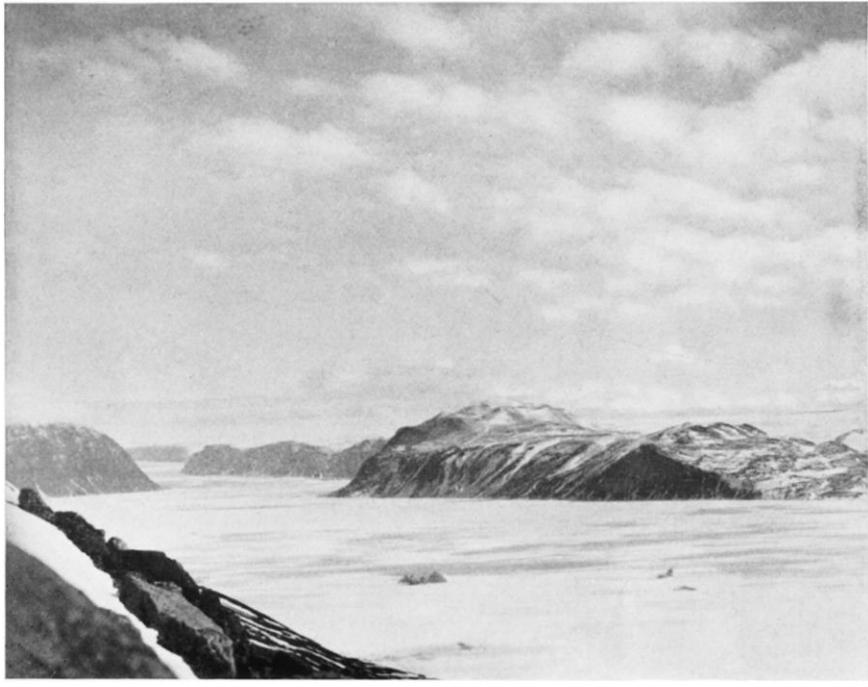
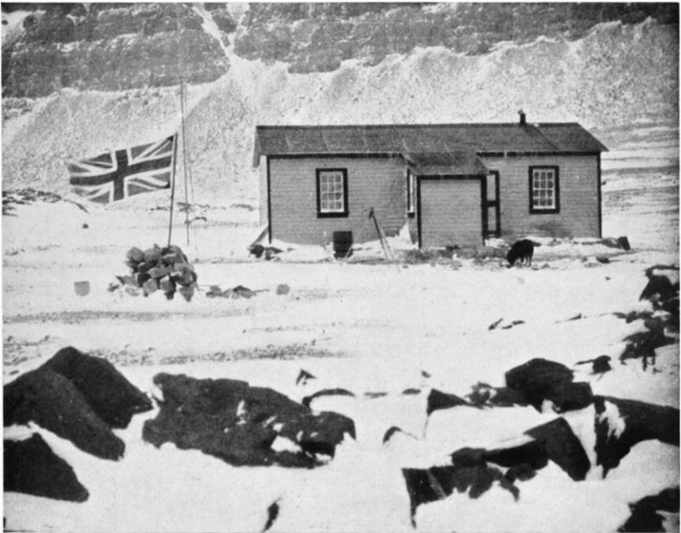
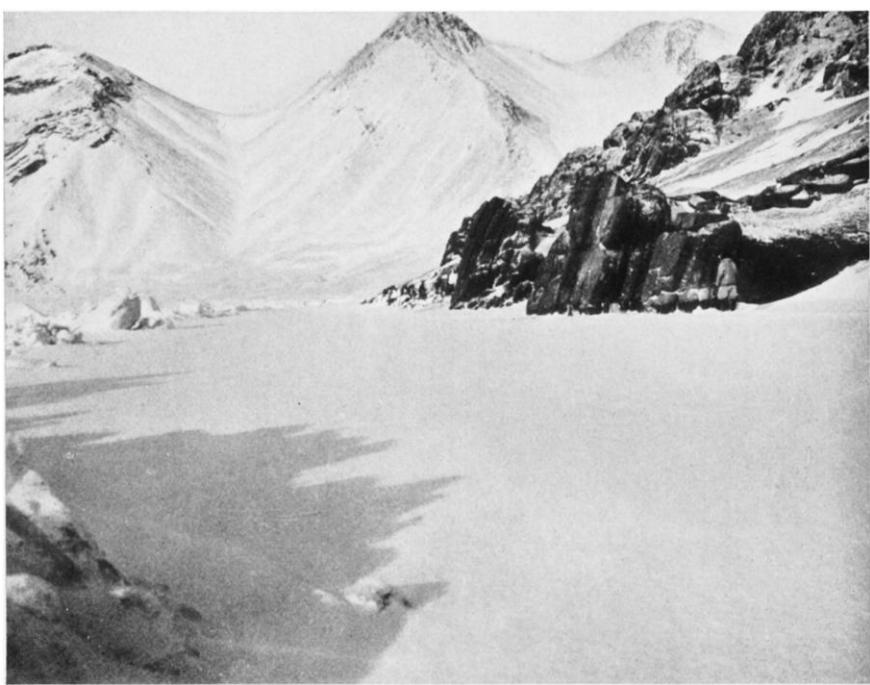
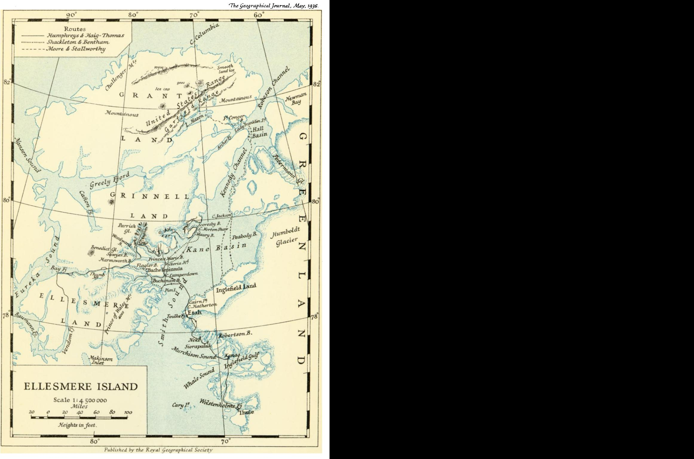

Ellesmere Land and Grinnell Land

Author(s): Noel Humphreys

Source: The Geographical Journal , May, 1936, Vol. 87, No. 5 (May, 1936), pp. 385-410

Published by: The Royal Geographical Society (with the Institute of British Geographers)

Stable URL:<https://www.jstor.org/stable/1785641>

JSTOR is a not-for-profit service that helps scholars, researchers, and students discover, use, and build upon a wide range of content in a trusted digital archive. We use information technology and tools to increase productivity and facilitate new forms of scholarship. For more information about JSTOR, please contact support@jstor.org.

Your use of the JSTOR archive indicates your acceptance of the Terms & Conditions of Use, available at https://about.jstor.org/terms

Wiley and The Royal Geographical Society (with the Institute of British Geographers) are collaborating with JSTOR to digitize, preserve and extend access to The Geographical Journal

# The

GEOGRAPHICAL JOURNAL

Vol LXXXVII No 5 1 R.G.S. >May 936

# OXFORD UNIVERSITY ELLESMERE LAND EXPEDITION: Papers read at the Evening Meeting of the Society on i8 November 935, by

 DR. NOEL HUMPHREYS, MR. EDWARD SHACKLETON, AND MR. A. W. MOORE

### Summary of the Work of the Expedition

### I7-20 July I934

 THE Expedition sailed from St. Katherine's Dock, London, in a Norwegian sealer, the Signalhorn. Severe head winds delayed the outward journey, and a solid jam of ice which blocked the whole of Smith Sound prevented the Expedition from reaching either Fort Conger or Bache Peninsula. Winter quarters were finally established at Etah (Latitude 78? i9' N.)

### August 21-October II (freeze-up)

 During the summer and early autumn, several boat journeys were carried out to Cairn Point in order to lay dep6ts of supplies for the spring sledge journeys. Biological collections were made in the neighbourhood of the base and hunting operations conducted.

### II October I934-2 April I935

 From freeze-up until after the sun left on October 24, sledging activities took place within the neighbourhood of the fjord. An attempt was made to reach Robertson Bay over the ice-cap, but this was prevented by bad weather, as were subsequent attempts during the winter night. The journey was finally accomplished chiefly by moonlight, at the end of January; the party returning on February 24 after a journey of approximately 300 miles.

 Mid-winter activities were controlled by the moonlight, and several sledge journeys were made to the Eskimo settlements and also north to the dep6ts both before and after the return of the sun on February i8.

### April 2-End of May

Three main sledge journeys were carried out by the expedition:

 Grant Land Party, consisting of Moore and Stallworthy, penetrated into northern Grant Land, north of the United States Range, finally reaching 25

 a point approximately in latitude 82?25', within sight of the Polar Sea at Clements Markham Islet. A new range of mountains, 1o,ooo feet high, was discovered, Moore himself attaining a height of 9000 feet. The party returned with geological collections, after covering about 9oo miles.

 Grinnell Land Party. Humphreys and Haig-Thomas ascended the Grinnell Land ice-cap, where, after sighting some new mountains, they were halted by deep snow. A crossing was then made into western Ellesmere Land, where a journey was completed between Bay Fjord and one of the fjords running out of Baumann Fjord. Geological and archaeological collections were made, and approximately 8oo miles covered.

 Scoresby Bay Journey. Bentham and Shackleton carried out geology and survey in the Bache Peninsula district, and the glaciers at the head of Princess Marie Bay were investigated. A journey was made later up the east coast of Ellesmere Land. Scoresby Bay was explored and mapped, and the Victoria and Albert mountains, which rise to a height of between 5000 and 60oo feet, were located on the shores of the Bay. Geological investigations were carried out north of Cape McClintock in lat. 80?. The total distance was approximately 8oo miles, and a geological collection was made.

## End of May-August 2I

 Biological and geological collections were made in the base area, while Haig-Thomas sledged ioo miles to Inglefield Gulf, where he carried out ornithological work. The ice broke up on July I i and on August 5 a 70-mile boat journey to Robertson Bay was completed.

### August 2I-II October 1935

 Return journey on the schooner Dannebrog. The party finally reached Barra in the Outer Hebrides on October i I.

# I. ELLESMERE LAND AND GRINNELL LAND DR. NOEL HUMPHREYS

 T HIS expedition was one of the many sent by the Oxford University Exploration Club. It originated with E. A. A. Shackleton and A. W. Moore, members of the Club's Sarawak Expedition in 1932, who planned to get up an Arctic expedition. Different fields in the Arctic were considered and the area eventually decided on was Ellesmere Island. For such an expedi tion it would be necessary to abandon the usual custom of the Club of sending summer expeditions and to be prepared to winter in the Arctic.

 Shackleton and Moore were joined by the writer and it was with this mem bership that the expedition was fathered by the Club and supported by Oxford University, the Royal Geographical Society, and many private sub scribers to whom our deep gratitude is due. Over seventy firms contributed most generously to the expedition. With this backing, the Canadian Govern ment gave the necessary permits, some financial assistance, and attached to the expedition Sgt. H. W. Stallworthy,, of the Royal Canadian Mounted  Police. Stallworthy had thirteen years' experience in the Canadian Arctic and spoke Eskimo. R. Bentham and D. Haig-Thomas joined the expedition later, bringing the total European personnel to six.

 According to the custom of the Oxford University Exploration Club separate members of the expedition were appointed as Leader and as Organizer, the writer being appointed in the one capacity and Shackleton in the other. Shackleton and the writer were surveyors, Moore was the photographer and assistant geologist, Bentham the geologist, and Haig- Thomas ornithologist; Bentham was also in charge of the wireless and the writer of insect and plant collecting.

 Ellesmere Island is the most northerly part of the British Empire; it is the largest wholly Arctic island and the largest normally unpeopled island, though at the present time there are two Royal Canadian Mounted Policemen stationed at Craig Harbour, in the extreme south of the island, giving the island the somewhat Gilbertian distinction of being the only country populated solely by policemen. The island is about 80,ooo square miles in extent, being roughly the size of the mainland of Great Britain, and is 540 miles long, while its greatest breadth is only 250 miles. Ellesmere Island is mountainous, the mountains in the east of the island being higher than those in the west. It is divided into four peninsulas, known, from the north southwards, as Grant Land, Grinnell Land, Ellesmere Land, and North Lincoln Land. Each peninsula has an ice-cap. The island has been crossed at each isthmus, but it is only in the south-east of Grant Land that the interior is known in any detail, as the result of Greely's Expedition of I88I-84. Not one of the four peninsulas has been crossed anywhere near its centre. Ellesmere Island was discovered by Bylot and Baffin in i6i6 and the part of the coast he saw he named Ellesmere Land. The island was not seen again until i818, when it was sighted by John Ross on the voyage which discovered the Cape York Eskimo, who were almost unaware of the existence of human beings other than themselves. The first landing on the island was by Dr. Hayes of Kane's Expedition in I854. The Nares Expedition of I875-76 was the first to penetrate Kennedy Channel. It established its winter quarters at Fort Conger and Cape Sheridan, and explored the greater part of the north coast of Grant Land, and mapped the east coast from Cape Isabella northwards. This expedition also explored a good deal of north-west Greenland, and Commander Albert Markham reached the most northerly point then attained on the Polar Sea. In 1881-83, a party under Lieutenant, afterwards General, L. Greely wintered at Fort Conger, explored the southern isthmus that separates Grant Land from Grinnell Land, and extended the coastal explora tion to Nares. Owing to the failure of the relief ship to arrive, the party went south by boat, reached Cape Clay on Bedford Pym Islands, and were eventually rescued in June, but only after dreadful privations, as a result of which seventeen men died. In I898-I902 an expedition under Captain Otto Sverdrup explored and mapped the Bache Peninsula area, and also did a great deal of scientific work on geology, biology, etc. They mapped Jones Sound, Baumann Fjord, Western Ellesmere Island, and Axel Heiburg Land. At the same time Peary was travelling up and down the coast of Ellesmere Island on attempts to reach the Pole. On the I898 journey he climbed the

 the Grinnell Land ice-cap, and claimed to have discovered Canion Fjord, afterwards mapped by Sverdrup. He also travelled over the whole of the north coast of Grant Land. But Peary added little to the exact survey of this region. In I906 he wintered at Fort Conger in another unsuccessful attempt. In 19I3-I7 MacMillan travelled over a great deal of Ellesmere Island, in his search for non-existent Crocker Land, and made a return visit in I923.

 The Royal Canadian Mounted Police established a detachment at Bache Peninsula, and several notable patrols were made. Owing to difficulty in relieving this station however it was transferred to Craig Harbour in Jones Sound.

 The name Ellesmere Land, first given to the landfall of Baffin, was after wards extended to the whole island, but by a more recent system of nomen clature the island is now called Ellesmere Island and the name Ellesmere Land is confined to the peninsula which includes the portion of the coast sighted by Baffin. The title of this expedition refers to the second use of the name, the objective of the expedition being the exploration of any part of the island. Long before the discovery of the island by Europeans Ellesmere had been inhabited by Eskimo, whose village sites dot the coast, especially on the west where, the mountains being lower, there are large areas free from snow in the summer. During European knowledge of the island it has not supported a population but it is a summer hunting ground for the Cape York Eskimo. These natives are cut off from the Greenlanders farther south by the ice-cap which, at Melville Bay, reaches the sea and leaves no littoral for human habitation. To the Eskimo living north of Melville Bay there were two land masses, North Greenland and Ellesmere Island, which is still known to them as Akilineq, or The Other Island.

 The Oxford University Ellesmere Land Expedition was on a larger scale than other expeditions sent out by the Oxford University Exploration Club, and that it started at all with the small initial resources of the subscriptions of the five members is due to the great ability and the enormous amount of work put in by Shackleton. Details of the organization will be dealt with by the organizer himself.

 The expedition left St. Katherine's Dock on July I7 in the M/V Signalhorn, a Norwegian sealer of ioo tons gross, which had been chartered for the pur pose. Food was taken for two years in case it should be impossible to relieve the expedition in I935. Survey instruments had been lent by the Royal Geographical Society and collecting material by the British Museum (Natural History). A wireless transmitter had been lent us by the Air Ministry. We were equipped with Nansen sledges for ice-cap travel and material for building Eskimo sledges for travel on sea-ice. We had ample equipment in the way of clothes and tentage, and a two-storied winter hut, i8 feet by iz feet, was to be waiting for us in sections at Godhavn. Dog pemmican was taken with us and this was to be supplemented by dried fish which we were to take on board at Greenland ports. Our Eskimo dogs we should also take on board in Green land. The Signalhorn encountered heavy weather in the North Sea. It was necessary to keep head on into the wind to avoid the loss of deck cargo, some of which was damaged. By August 4 we were off Holsteinsborg in a thick mist and for the first time since leaving Scotland saw land, a rock awash,

 which we only just avoided. As the Captain considered that it was impossible to reach Holsteinsborg while the mist held, we made for Godhavn, which we reached next day. Here we found our hut which was to be our winter quarters unless we wintered at the abandoned police station at Bache. Stallworthy was kept very busy bartering with the natives for such equipment as dog-lines, dog-whips, and dog-harness; and selecting the dogs. On the 6th we left for Jakobshavn where we took on board dogs and dried fish. Returning to God havn we shipped the hut, dogs, and more dried fish, and left on the 8th with seventy-one dogs and as much dog food as the Captain would allow us to take on board. We reached Thule on the i ith and left the same day, reaching Robertson Bay on the I2th. Here we received telegraphic permission to take with us two Eskimo and their wives who were known to Stallworthy, in place of the natives who had been detailed to us by the Danes. The Eskimo were Nukapinguaq and his wife Enilungwa and Inuatuk and his wife Natuk. While at Siorapaluk, the village in Robertson Bay, we were able to trade for further equipment. We also made a cache of food and ammunition, as it was at this time our plan to await here the relief ship which should fetch us in the summer of I935. While these arrangements were in progress we gave a party on board to the children of Siorapaluk. Quite small boys came out in their kayaks and clambered aboard without assistance. The girls were brought

out in our whaleboat. We entertained them with biscuits, sweets, and the

 gramophone. The children had perfect manners and were entirely at their ease. The bigger children looked after the smaller ones to see that they had their full share of the entertainment.

 We left Robertson Bay early on August I3 on our first objective, which was to reach as far north as possible on the Ellesmere Island coast, and there establish winter quarters. Our hope was to reach Fort Conger, which would be an ideal base for the exploration of Grant Land which, of the four peninsulas of Ellesmere Island, appealed to us most. We already knew that the ice conditions this year were abnormal. Wordie had failed to pass the ice of Melville Bay, and Bartlett had been similarly frustrated. While pushing through the ice floes we took the opportunity of hunting such walrus as we encountered, and killed and took aboard seven. That evening we sighted Ellesmere Island. The next day we reached pack-ice which blocked Smith Sound. We made a landing near Cape Hatherton, and left a cache of food and ammunition, and also killed an additional walrus. Our inability to penetrate into Kane Basin was a great disappointment to us. We had hoped to establish our base at Fort Conger, or at worst to make winter'quarters at the abandoned police station on Bache Peninsula. We hoped now to be landed on the coast of Ellesmere Island somewhere within reach of Bache; however our Captain, fearing that the pack-ice would break up and come south, made for Etah, where we waited until the i7th, when he agreed to make another attempt to penetrate Smith Sound or, alternatively, to land us on the coast of Ellesmere Island. We found the pack still unbroken but now extending south of the cove near Cape Hatherton where we had made our cache. The Captain abandoned the attempt to reach Ellesmere Island and returned to Etah. He now told us that he would make no further attempt to get north and that unless we were willing to be landed at Etah he must immediately

 go south; further, that if the pack broke up he must immediately start south lest he should be shut in Foulke Fjord for the winter. In these circumstances we decided to make winter quarters where we were, and the next five days

 On August 22 the Signalhorn moved slowly from her moorings opposite Etah towards the mouth of Foulke Fjord. We were meanwhile rowing ashore in the whaleboat with our last load. As the noise of our oars began to drown the sound of the Signalhorn's engine we suddenly heard the ship's siren; Captain With was morsing us a farewell message. The weather was perfect. It was warm enough to sun-bathe. There was however urgent work before us. Seventy tons of equipment and stores had been landed below spring-tide high-water mark. Cases with contents 100 lb. and hundredweight sacks of coal were to be carried up a steep bank. Timber for the hut had yet to be sorted and carried to the site for winter quarters. Caches would have to be made of the walrus meat and dried fish, to protect it from the Eskimo's dogs which had been turned loose on the mainland. These things we considered as we rowed ashore. After pitching tents in case the weather should suddenly break, we were busy manhandling the stores and equipment up a steep 25-ft. bank to the site of the camp, a piece of nearly level ground where was the site of the deserted Eskimo village and of Borup Lodge of MacMillan's 1913-I7 expedi tion. As soon as the timber was brought up and sorted out the actual erection of the hut on part of the site of MacMillan's Lodge was undertaken by Stallworthy with Bentham as chief assistant. Haig-Thomas and Moore, with the assistance of Inuatuk, were now busy making trips by boat for the purpose of hunting walrus and making caches as far north as possible. Mean while Shackleton was sorting out the stores and equipment and the writer was collecting such plants as were still in flower. Later all members of the expedition were available for the hunting and cache-laying trips. Altogether some ten walrus and a number of seal were killed and cached whence the meat could be fetched by sledge in the winter. A large cache of human and dog food was made at a point known to us as Cache Point, a little north of Cairn Point. The pack-ice remained firm in Smith Sound and prevented us from getting into Kane Basin. For these trips we used a whaleboat with inboard motor and a small dory with outboard motor. The journeys were not without incident. Twice a boat was charged by a walrus, which was shot at close range, and on one occasion Shackleton and Moore were obliged to lift the dory on to a floe on which they drifted for eighteen hours.

 At the beginning of October we made our last boat trip. The fjord was quickly freezing up. We had been greatly handicapped by the terrific winds which for days on end had prevented us from using the boats. We were, moreover, discovering the unsuitability of Etah for winter quarters. Walrus do not now visit the fjord and there are few seal. Large land game have long ago been exterminated in the neighbourhood. Our dogs had been landed from the Signalhorn on a small island in the fjord, known to us as Dog Island. This was necessary to prevent them from damaging our equipment before the hut and store had been completed. Unfortunately the strong winds had prevented us from getting to the island regularly by boat to feed them. More over they were so wild that when we landed with food many ran away and

were spent in landing our equipment and stores.

 could not be fed. Some had died or were killed by the other dogs and we found only their skulls. As the fjord began to freeze over, ice floes drifted against the island and when, by a change in the wind, the floes were blown away from the island, dogs were liable to be taken adrift. On one occasion we were able to row out and rescue four dogs from a floe. It is possible that on other occasions dogs drifted out to sea and were not recovered.

 As soon as it was no longer possible to continue our cache-laying boat trips, we made dog-lines and harness and fetched the dogs from the island. On our last trip to Dog Island, on October 8, the sea was freezing so quickly that we got stuck in the ice on the way back. We had got wet to the thighs on the way back and at one time it seemed certain that we should have to stay in the boat until the ice was thick enough for us to walk ashore; however after several hours' hard work we were able to break a lane in the ice and reach the mainland. When the fjord was frozen over the remaining dogs from Dog Island came over to the mainland. One could not be caught and was shot. We now had fifty-five dogs from our original seventy-one. These were divided among the six of us and they soon became docile and got to know their individual masters. We each of us now had a dog team and practised dog driving on the frozen fjord. It took us a long time to get our teams together and to learn the art of dog-driving; it was especially difficult to acquire the knack of using the 30-foot dog whip. We found the Nansen sledges ideal on fjord ice as they would have been on ice-cap, but that they would not stand up to rough sea-ice. We found later that the Victoria ash, which we had brought for the runners of the sledges which the Eskimo built for us, was very heavy and that for these a team of about fifteen dogs would be necessary. Our dogs were now reduced to forty-seven, as during the winter we had had some deaths from poisoning from dried shark flesh. In these circumstances we reduced our teams to three. The tedium of the winter was largely relieved by our wireless. We were able to get messages sent from Pittsburg and from Winnipeg, and we heard wireless programmes broadcast both from England and from America. A Christmas greeting from the B.B.C. we did not hear, but we got a message and a special selection of dance tunes played for us.

 Early in November Stallworthy, the Eskimo, and I had twice attempted to reach Robertson Bay by the ice-cap, but on each occasion the attempt had failed because of blizzards. For a long time after these attempts we had been waiting for the ice to form beyond the fjord so that we could travel by sea-ice to Robertson Bay or Thule, but as soon as the ice formed, and before it was strong enough to bear the weight of sledges, it was broken up by the Etah winds. The Eskimo do not care to travel by ice-cap and wished to wait until it might be possible to do the journey by the coast. Fearing however that further delay might affect the date of our first journey north, I persuaded the natives to make another attempt by the ice-cap, and a start was made on January 28 by Haig-Thomas, the two Eskimo, and myself, with two sledges and dog teams. The weather was perfect and we got up the glacier without difficulty and travelled across the ice-cap until dark. We then built two small iglus, in which we spent the night. Next day we continued across the ice-cap and down a broad glacier to Neke, where is one Eskimo family, probably the most northerly family in the world. On continuing our journey in the dark

 we were accompanied by Eskimo on two sledges returning from Neke to Robertson Bay, which we reached at i i p.m., and slept in a native iglu. We had left a store of food at Robertson Bay on our way to Etah last year and were able to barter for dog food and equipment. We stayed another night here and left in the early afternoon with three natives with their sledges and teams, one native having with him a small boy whom he was taking to Thule to be treated for tuberculosis. The next part of our journey lay along the coast. After the daylight had gone we had a wonderful display of northern lights until we reached the village of Kanaq in the evening. Sleeping again in a native iglu, we started early and ascended a glacier. We left the ice-cap by a steep valley nearly free from snow, the Eskimo showing great skill in guiding the sledges so as to avoid rocks. The valley led to a fjord, which we followed to the sea. Here we found that my sledge had been damaged, but a native who was hunting seal took over my sledge and lent his own. We travelled on through the night, reaching Thule at 3 a.m.

 During our stay there the natives were busy making for the expedition additional sheepskin-lined seal-skin mitts and kamiks, and dog-harness. Also we were able to buy uksuk (phoca barbata) thong for making dog-lines, lash-lines and whips. We had ordered similar equipment at Siorapaluk, the settlement at Robertson Bay, to be made as soon as permission was received from the Governor at Thule; this permission had been sent in a letter taken back by Nukapinguaq who had returned immediately from Thule with instructions to bring his wife, who was tubercular, for treatment in the Thule hospital. The delay would give the natives at Siorapaluk time to make the equipment. Several times while at Thule I had spoken by wireless to Etah, and listened for a reply in morse but had heard nothing. By February 14 no reply had been received to the Governor's cable to Copenhagen, so we decided to start back to Etah on the morrow. The Arctic winter was now over, the sun was above the horizon though not visible from Thule. The next day we set off heavily laden with stuff we had bought in Thule. We were seen off by the entire station and left it with great regret, though anxious to be back at Etah as soon as possible. Although no reply had been received from Copen hagen the Governor made the concession that it would be sufficient if we brought our Eskimo back by the end of May to any part of Greenland south of the Humboldt glacier. He also gave us permission to arrange with the natives at Kanaq, Siorapaluk, and Neke to help us on our journey north from Etah. Already, as we left Thule on February I5, the hills were rose-tinted, and soon afterwards we experienced the greatest thrill of the Arctic year, the first glimpse of the sun, flaming above the horizon and crimsoning the entire landscape. But the coldest part of the year was not necessarily over; often in the Arctic the lowest temperatures are experienced after the return of the sun. Returning to Etah we were a party of four sledges: besides Haig- Thomas's and my sledges we were accompanied by two native sledges. That evening we reached the glacier where is the first land crossing. Here was the iglu we had built on the way out from Etah. The natives now built a second iglu and here we stopped the night and all next day, as the Eskimo said there was a storm on the ice-cap. We continued our journey at i p.m. on the i7th and reached Kanaq at 5 a.m. the next day. We stayed in a native

 iglu and left at i p.m. next day, reaching Siorapaluk at 9 p.m. that evening. We stayed the night with Enoq, who has a small store, certainly the most northerly store in the New World. We found that the letter from the Governor giving permission for the equipment to be made for us had not reached Enoq and that for this reason the Eskimo women had not started working on the equipment. Enoq however took our word that permission had been granted and the work was put in hand at once. At Thule I had had a cable telling us that we should be relieved at Etah. The cache we had made the previous summer was thus conveniently available for paying for the equipment being made for us. The day after our arrival here we moved to an empty iglu so that we could do our bartering without disturbing Enoq. We also arranged with Eskimo, as we had done at Kanaq, to help us on our northern journey. Some would travel with us to Etah and others would follow. The next day, collecting such kit as was ready, we continued on our journey, reaching Neke at i a.m. on February 2I. The Governor at Thule had given us permission to engage, as permanently employed native in place of Nukapinguaq, Apilaq; and he and his wife and child, also Kokochea and his wife, joined us and we continued our journey the same day. On the ice-cap we ran into a blizzard which made travel impossible. The force of the wind was so great that it was quite impossible to build an iglu. The natives thereupon dug a hole in the ice-cap and from it carved out two caves, into which we crowded. This took two and a half hours, by the end of which time Haig-Thomas and I were very cold as our fur clothes were packed on the sledges and the wind was so strong that it would have needed several people to unpack the sledges without some of the things being blown away. Our ice cave was 612 feet square and 4 feet high and held six of us. Here we remained stormbound for three days, com pleting our journey to Etah on February 24.

 This was about the time we had hoped to get off on our preliminary cache laying trip, but many disappointments were in store for us. Of the three Green land sledges for which we had material, two were unfinished and the third unstarted. There were a number of other things to be done, but none which might not be completed before the sledges could be finished. Inuatuk went sick as soon as we returned and also had an injured hand; and at one time said he was unable to go north at all. Apilaq, our other permanently employed native, also became ill and decided that even when well enough he could not go north. His sickness turned out to be lobular pneumonia, and after he recovered he returned home. Apilaq's place had to be filled. Porsman, who had come with us from Thule, volunteered for the post and we managed to get a letter through to the Governor at Thule and he wirelessed us the neces sary permission. While Haig-Thomas and I had been away, the last of the walrus meat had been brought in from the caches. Owing to the unusually open season it had been impossible earlier in the year to reach some of these. The caches yielded less dog-feed than we had expected. Some had been entered by foxes and one had been opened first by a polar bear. Half a cache had been used by Nukapinguaq who, on leaving Etah, instead of taking his wife to hospital, camped on the coast south of Etah, where he hunted walrus. Being unsuccessful in this and being without dog-feed he had used our cached meat. Before the end of February all dog-feed except pemmican was finished.

 During March we had a fluctuating number of Eskimo at Etah. These were chiefly the hunters who had come in response to the arrangements we had made and who intended to go north with us. There had however been in their villages a shortage of dog-feed during the winter and the hunters were unwilling to start before they had got their dogs in better condition. We gave the natives pemmican for their dogs, but this was considered unsuitable for enabling the animals to put on weight and the Eskimo, after failing to get walrus locally, returned to their villages. They expected to be able to hunt walrus farther south and promised to return as soon as their dogs were in better condition. With the idea of also fattening up some of our dogs Moore went with some of the Eskimo, himself driving a team of twenty-one dogs. Two out of our three dog-teams were taken, but it was found that the same shortage prevailed in the villages and Moore returned with the next lot of natives coming to Etah, the dogs returning thinner than they had been before the journey.

 As the natives returned to Etah we were once again very busy providing for their various requirements: cooking for them on arrival, issuing them food, or nursing the sick. We however got the men to work on the sledges, which were finished on March 17. This was a month later than we had hoped to get off and another relay trip to Cache Point was still necessary. We had during the winter been cut off from our cache by the absence of continuous ice-foot. There had moreover been little snow locally and the Eskimo had considered up till now that it would not be possible to take heavily laden sledges overland. Had we been able in the autumn to establish a cache at Cape Jackson we could have reached the cache, at any time in winter when there was a moon, by the ice-cap; but our cache as established was far from any glacier and so could not be reached from the ice-cap. Handicapped as we were by these circumstances we considered it worth while postponing our journey for another fortnight if necessary for getting the help of the hunters, instead of starting at once with only our two permanently employed natives, especially as they would have started, in the circumstances, unwillingly. Owing to the lateness of our start and to the fact that our cache was such a little way north of us it would be necessary to rely largely on seal, which do not lie on the ice much before the middle of April or May. For this reason it was important to split up into three parties. A large party would be unable to support itself by hunting. The number of Eskimo at Etah varied from day to day and the proportion of those who were willing to go north with us varied almost hour by hour. On March i8 there were five Eskimo who, though not willing to go north on the big trail until the end of the month, would help us on a relay journey overland to Cache Point, and this day was spent "packing" our loads 800o feet up the hill behind our winter quarters. The next day at about noon we started off. All the dogs were harnessed to each of the sledges in turn and they were so taken to where we had carried the loads the day before. The land crossing turned out to be a hard journey, as there was little snow and it was necessary to assist the dogs by pushing the sledges the whole way to the divide. Shackleton's and my team was so overloaded that when we reached the divide the dogs' and our combined efforts failed to move the sledge and we had to unload and "pack" the loads over the ridge. Beyond the  divide it would be easy going downhill. Just as we were ready to start again an Eskimo returned to say that they and Moore and Haig-Thomas had reached the sea with their sledges but found that the condition of the ice made it impossible to travel farther. They had all left their loads on the coast and were returning. At this moment Bentham and Stallworthy caught us up. They had had an accident to their sledge which had fallen 15 feet, turning upside-down and breaking the sledge handles. Luckily they had themselves fallen clear of the sledge. We now left our loads at the top of the snow slope and as soon as the others returned up the hill we went back to Etah. We were rather depressed by the journey. We were exhausted by pushing the sledges and we were cut off from our cache. We had discovered that the sledges were much too heavy; on sledges half the weight we could have loaded as much as the dogs could pull. The weight was partly due to their unnecessary length and partly to the weight of the runners of Victoria ash. Soon after this journey other Eskimo went south to their villages. By the last to go we sent a message that we were definitely going north at the beginning of April and all who were going with us must be at Etah by the last day in March. At 2.30 a.m. on March 30 eight sledges arrived, with seventeen Eskimo and Dr. Holm, who had come from the hospital at Thule and was visiting outlying villages. The Eskimo included some who were willing to go north with us, and two more arrived the next day. We now had a population of thirty-two at Etah, as some of the Eskimo had brought their families. Besides our two permanently employed Eskimo, Inuatuk and Porsman, ten hunters were now found willing to go with us, and these included Nukapinguaq, whose knowledge of Grant Land was likely to be invaluable.

 During our journey out to Greenland our plan had been to winter on the east coast of Ellesmere Island as far north as possible. At best we were to winter at Fort Conger, in Grant Land; at worst we should winter at the abandoned police station in Grinnell Land. Before establishing our winter quarters we should have unloaded from the Signalhorn a store of food and paraffin at Robertson Bay, where we expected to await the relief ship on the completion of our explorations. Our first disappointment at having to winter at Etah was somewhat modified as we learnt more of the conditions of travel in this part of the Arctic. Ice conditions for sledging north from Smith Sound are better along the Greenland than along the Ellesmere Island ice-foot. This is due to the prevailing wind which piles up the ice against the Ellesmere Island coast, and also to a heavier snowfall on that side of Kane Basin. Had we wintered at Bache we should probably yet have found our best route to be by the Greenland ice-foot. Also our return journey from the north in the spring would have to be down the Greenland coast if we wished to stay north as long as possible, as, were we to return via Bache, the danger of an early break-up of the ice in Smith Sound would necessitate a comparatively early return. Moreover wintering at Bache and travelling to Robertson Bay after our spring journeys would mean abandoning at Bache much of our equipment, whereas in our present circumstances we could await the relief ship at our winter quarters and put on board everything that was worth taking home, including our autumn collections. By following exactly the same route on our return journey as on our outward journey from winter quarters we could

 leave caches of food, paraffin, ammunition, and photographic material, which would speed-up our southward trip.

 Our objective was the exploration of the interior of Grant Land, Grinnell Land, or Ellesmere Land. At Etah we were within easy striking distance of the last two but depressingly far from Grant Land, which was our preferred objective. As the ice did not break up in Smith Sound in 1934 our boat journeys had not enabled us to make caches farther north. Terrific winds in the winter and the nature of the coast had prevented an ice-foot forming at the mouth of Foulke Fjord, and we were thus prevented from sledging north along the coast during the winter and the small snowfall had prevented sledging over land to the pack-ice. Retaining Grant Land as our preferred objective we, during the winter, considered alternative routes to that along the Greenland coast, known to us as the sea route. This route had the advantages that, in being much better known, there was much less likelihood of unforeseen diffi culties; that there is usually open water at Cape Jackson where seal could be caught at any time in the sledging season; and that it would be possible to catch fish at any time in Lake Hazen. The Eskimo however preferred a route across Smith Sound, up Flagler Fjord, across the isthmus between Grinnell Land and Ellesmere Land, and then by ice-foot and fjord ice to Western Grant Land. This route, known to us as the land route, had many advantages. According to the Eskimo there was more game on the west of Ellesmere Island. The route is shorter. We should reach the west of Grant Land, the interior of which is entirely unknown, instead of the south-east of Grant Land which is the only part of the interior of Ellesmere Island which was already explored. Our geologist considered that this route would provide the best field for his work. According to the Eskimo and to Stallworthy, our technical adviser, it would be inadvisable for any of the members of the expedition to travel with out Eskimo on sea-ice in the spring, and it would be necessary, if we went by the sea route, for the eight of us with our five sledges to keep together, unless some were to return early along a coast already known, where little useful work could be done. By the land route we should have advanced bases at Bache and Fram Haven, where there were shelter, food, fuel, and ammunition. It would be possible for the whole party to cross to Western Ellesmere Island and then for picked teams to go on to Grant Land. The support parties could then retire on Bache and could use the station as a base for the exploration of the interiors of Grinnell Land and Ellesmere Land, without going over sea ice, and could there await the return of the Grant Land party so that the whole expedition could cross Smith Sound together at the end of the trips. Certain modifications of the land routes were considered. If we could cross the Grinnell Land ice-cap to Greely Fjord from Dobbin Bay, or some other bay in the neighbourhood, we should be passing through unknown country and should still further reduce the length of our route. The Eskimo have an ingrained aversion to travel by ice-cap, but considered the project feasible. They estimated that owing to the bad ice conditions of that part of the Elles mere Island coast it would take six days to get from Bache to Dobbin Bay, and that it would take eight days to cross the Grinnell Land ice-cap. An alternative modification was to cross Grinnell Land from one of the glaciers at the head of Princess Marie Fjord to Canion Fjord. From information

 Haig-Thomas and I got from natives at Siorapaluk this crossing had actually been made by Eskimo. Such a crossing would be less direct than that con sidered from Dobbin Bay and would pass through partially known country, but it would be more likely to be easy to accomplish.

 On these considerations and oa the assumption that we should have the assistance of not more than two Eskimo our plan, as decided on for the spring, had been that as soon as the ice-foot formed or there was enough snow for a land crossing to Cache Point we should take the rest of our necessary stores to our main cache and as soon after the middle of February as possible cross altogether to Bache. It would not be possible to take all the loads across Smith Sound in one journey, so while the main party was returning to bring across further loads a small party would reconnoitre to find out the possibilities of a crossing by the Grinnell Land ice-cap. As soon as the expedition was once again together a crossing would be made to the west coast of the island. Further plans would depend on the amount of game on the west coast. If it were plentiful the whole expedition would travel to Grant Land and there break up into three parties. If there should be a shortage of game two parties would be in support and return to Bache whence they could do exploratory and geological work until the return of the Grant Land party, when the whole of the expedition would cross Smith Sound together. Now that we had twelve Eskimo to help us we could at any time split up into three parties. The advantages of this had all along been obvious to us. We should cover more ground and move more quickly: and being partly dependent on game, a small party would be at an advantage over a large party. Early in the expedition, before we had considered the land route, when we found that we had only enough dogs for three teams, Bentham's and Stallworthy's teams had been joined, Moore's and Haig-Thomas's, and Shackleton's and Humphreys's. This was with the idea that we should be operating in three parties in Grant Land. The geologist would not be operating so far from the advanced base as the others and with the assistance of Stallworthy's experience could dis pense with the help of the Eskimo; the two surveyors with one Eskimo would work together, while the other two members of the expedition would make rapid journeys with the other Eskimo. But the expedition was now rearranged. Moore and Stallworthy were to attempt the exploration of Grant Land, making if possible a crossing as near the centre as possible. Shackleton and Bentham formed the geological party. The third party was to attempt the exploration of the interior of Grinnell Land and Ellesmere Land. The chief advantages of the land route over the sea route had now disappeared and routes were left to each party to decide for itself. The best dog team, which had been Bentham's and Stallworthy's, was detailed to the Grant Land party; the second best, that of Shackleton and Humphreys, went to the geological party, and the remaining team to the Grinnell Land party.

### Journey to Bache

 In one way our party was handicappe.d by having no permanently employed native. We had however, in addition to Utah and Kokachingwa, who were to return as soon as the five sledge loads were reduced to three, two hunters who promised to stay with us until the end of May. These were Kuchiketo

 and Kokochea. All April i was spent in preparing for the journey. We took two pyramid tents, one of which was to be sent back later with the support men. These tents had been left erected experimentally for a long time in the autumn and afterwards strengthened where they tore. The strengthened tents were entirely satisfactory. They were lighter, warmer, and stronger than other tents of the same size, and quicker to erect or strike. In the apex of the tent, above the circular entrance, the heat from the stove collected sufficiently to dry our clothes while we cooked our evening meal. We gave the Eskimo all the clothes and sleeping-bags they wanted. Haig-Thomas and I took each a heavy and light sleeping-bag, five pairs of seal-skin boots with detachable sheep-skin linings, and three pairs of seal-skin mitts, similarly lined. Actually during the trip I only used one pair of seal-skin boots as it was always possible to dry the linings at night. We each had a set of woollen underclothes with a set in reserve. Haig-Thomas had breeches of polar bear skin and I of moleskin cloth with Grenfell cloth trousers as well, though I seldom wore them. We each had a Mackinaw shirt and over that Haig-Thomas wore a sweater and a moleskin cloth parka with duffle lining, and I a couple of sweaters and a Grenfell parka. It was seldom necessary to wear all these clothes, and we were never cold during the journey. We took with us in addition reindeer-skin parkas, trousers, and overshoes, but these were unnecessary and we soon discarded them. As the only chronometer and portable wireless set were with the geological and survey party, and as we were intending to cover as much ground as possible, we reduced survey instruments to one prismatic compass. We had exchanged with Utah our heavy sledge for a small one of soft wood which was much lighter and was big enough to take all that our team of dogs could pull. We got off on April 2 and were the first party away from Etah, Shackleton and Bentham volunteering to stay and tidy up the camp after the other teams had left. Shackleton was also busy distributing food for the use of the Eskimo women and children until the return of the hunters.

 Our sledge and loads were already at the top of the hill, but the sledges of the Eskimo were at Etah and they started by a different route. From the top of the hill we followed what was now known to us as the "pemmican" trail. Near the divide we had a mishap which might have been serious. Driving down a steep snow slope the dogs got out of control. They headed straight for a slope which was nearly precipitous, and they could not be stopped. At the last moment Haig-Thomas and I rolled off the sledge. It seemed inevitable that the sledge would go over the edge, but at the last moment the dogs swerved and stopped. The sledge swung sideways and came to rest within a foot of destruction. Soon after we had continued our journey we were overtaken by the Eskimo. Just beyond the divide, at the top of the long snow slope, were some of the loads left on the "pemmican" trip, others having already been taken forward by Inuatuk. After taking the remaining loads on our sledges the Eskimo helped us down the slope. The slope was so steep that even with a man hanging on to the handles of the sledge and so acting as a brake the sledge would travel faster than the dogs could gallop. In such cases the dogs have to be whipped to one side so that the sledge shoots past them and they are dragged behind as an additional brake. At the coast just beyond the foot of the slope

398

 were the rest of the loads which had been taken there on the "pemmican" trip. Here we had tea and rested the dogs. We continued our journey by sea-ice to the cache in Hatherton Bay which we had established from the Signalhorn last autumn. Here we built a snow iglu for the night. This was the only iglu built during the trip, as the Eskimo preferred the pyramid tent. The next day we travelled by ice-foot to our main cache at Cache Point. At two places the ice-foot was covered with hummocks and here a great deal of chopping was necessary and took several hours of very hard work, at which the Eskimo showed amazing skill. But for the fact that the other two parties would be able to use the way we had made, it would have been better to have passed these points by a detour inland. During this part of the journey wet passed the site of the first cache laid in the autumn, afterwards transferred farther north. Here we found a sledge-box of provisions which we took along with us. We also passed the last cache made in the autumn, but our loads were as much as we could carry and we left the contents for the other parties. We reached the main cache at Cache Point at 8.30, and there camped.

 We were up at 4.30 and found that Moore's party had arrived during the night. The next day was spent in preparing for the crossing to Ellesmere Island. Haig-Thomas and the Eskimo opened all the boxes of dog-pemmican in the cache, while I filed the runners of our sledge. Later the natives filed their runners and Utah mended his sledge. In the afternoon Moore and I counted the tins of dog-pemmican. There were eighty-four and a half tins of 48 lb. each. Haig-Thomas and I took twenty-seven of these and the Grant Land party left the same number for the geological party. There was a shortage of cooking pots and ammunition, so the Grant Land party took what they required, and we arranged to draw what we should need from the abandoned police stations at Fram Haven or Bache Peninsula. We were up next day at 6.30 and off at 8.30. We first travelled north on sea-ice and then west towards Pim Island. The ice conditions were good. We stopped four times to hunt seal at their breathing holes and two were shot. We passed bear tracks but they were all old. We camped on sea-ice and next day continued our journey towards Pim Island. More bear tracks were seen but all were old, except in one place where the footprints had been made the day before. The conditions remained good until we got near the coast of Ellesmere Land. Here were pressure ridges which made travel difficult, so we left some of our loads on the sea-ice and travelled to Fram Haven lightly loaded. Here next day we drew stores, made a list of what we had taken, replaced the boxes, and returned to our loads beyond the pressure ridges. Packing the loads on to the sledges we travelled towards Cape Camperdown, off which we camped on sea-ice. The ice conditions were bad because of the pressure ridges and the deep snow between them. No seal holes were seen, but many bear tracks, mostly old. The next day we travelled slowly over the pressure ridges to the ice-foot where we left most of our loads and then had an easy run along the ice-foot to Bache Police Station. From the station next day Haig-Thomas went with some of the Eskimo to shoot seal in a patch of open water in Flagler Fjord. Meanwhile I polished the runners of our sledge and two Eskimo re-made a sledge from material found at the station. Utah, who was much older than the other natives, rested all day. In the afternoon the geological

 party arrived. In the evening the hunters came in with six seal, of which Haig-Thomas had shot five, and a hare. We were unable to get the Eskimo to start next day, so Haig-Thomas went off again with Eskimo to hunt seal in Flagler Fjord. They took an iceboat from the station and floated it, but most of the open water of yesterday was now covered with mush ice which the boat could not penetrate and only one seal was bagged. Meanwhile I went inland with Bentham, who was geologizing.

### Grinnell Land Trip

 The next day in the afternoon we got off and travelled easily along the ice foot to our cache at Cape Camperdown, passing on the way many fresh bear tracks. The weather was so mild the following day that we decided to leave here our reindeer clothes and second sleeping-bags and to reduce our seal-skin boots to three pairs each. This day's journiey took us past Cape Albert, a magnificent headland looking like a Norman castle. Beyond this we passed the remains of a landslide. Enormous boulders had bounded over the hum mocks and lay on the sea-ice 50 yards from the ice-foot. We followed the ice foot past Cape Henry and up a fjord known as Bartlett Bay, crossing it to the ice-foot on the other side. At Victoria Head we camped, the Eskimo going off to hunt seal unsuccessfully. Our first objective was to attempt a crossing of Grinnell Land ice-cap from one of the Hays just north of the entrance of Princess Marie Bay. The next morning we made for our return journey a cache of paraffin, human pemmican, biscuits, and tea, and crossed the bay, passing just south-ywest of Norman Lockyer Island, and camped at a cape on the west coast of Franklin Pierce Bay just north of that island. Leaving the other Eskimo to make camp, Haig-Thomas, Kuchiketo, and I drove on along the ice-foot to the valley at the head of the bay. The Admiralty Chart shows a glacier from the main ice-cap of Grinnell Land terminating in this valley. Driving up the valley we soon got into deep soft snow, which got deeper as we advanced. Eventually we could take the sledges no farther and we went on foot. We were,now in unexplored country. We made our way slowly up the valley, the snow becoming thigh, and then waist deep. We found recent tracks and fresh dung of musk ox. This was interesting as in this part of Ellesmere Island musk ox were believed to have been exterminated. Mid night found us still plodding up the valley. Near the head of the valley we climbed a cliff in order to get a view northwards. There was no glacier within sight. We now returned, reaching camp at 4 a.m., and the next day, keeping to the ice-foot, we rounded Cape Harrison and reached a small bay at the mouth of Copes Bay, opposite Cape Field. Here we left the ice-foot and went on to the sea-ice, where however travelling was slow as there was deep snow. Farther on we were able to return to the ice-foot where travel was easy. We camped on the ice-foot and next day reached Parrish Glacier at the head of the fjord. Here was glare ice and the glacier itself was almost free from snow. The Eskimo were unwilling to travel farther this day as they expected a blizzard, so we camped. Haig-Thomas that evening went with the Eskimo up a hill on the west of the glacier to choose a route for the next day while I collected rocks along the coast.

The next day we decided that the supporting natives, Utah and Kokachingwa,

The "Signalhorn" in loose pack

Robertson Bay, N.W. Greenland

Abandoned police detachment at Bache Peninsula

Good ice-foot on E. coast of Ellesmere Land

This content downloaded from 132.174.250.38 on Tue, 08 Sep 2026 22:58:56 UTC All use subject to https://about.jstor.org/terms

 should return. We could carry on three sledges all that we should need for the attempted crossing of the ice-cap. We divided up our loads: part was to go with us; part was to return with Utah and Kokachingwa, and part was to remain at the foot of the glacier. This last included much of the dog-pemmican in order to lighten the sledges and because the Eskimo thought that should we get across we should find plenty of game in Greely Fjord. Early in the afternoon we drove without difficulty straight up the glacier. The glacier had just enough snow to make the surface nearly perfect, but the slope was steep and the dogs got tired, so, nearly at the top of the glacier, we left six tins of pemmican behind and these were fetched later on by the Eskimo while we were pitching camp. It was a warm though windy night, but next day was misty and calm. The natives would not travel this day because it was misty and they expected the wind to return. The next day was also calm and the visibility good, but in the morning the natives were still unwilling to travel. We were camped in unexplored country and were now able to get a view into the unknown interior. To the east high cliffs shut out any extended view. Some miles north of us were mountains, but on each side of them, and also to the south-west, the ice-cap continued to an unbroken horizon. To the west were cliffs and at a distance, estimated at 50 miles, was a single high conical peak, the bearing of which we took. The weather kept fine until noon, when the Eskimo agreed to go on. We started soon afterwards and travelled north towards the mountains ahead of us, hoping from them to set a compass course to Greely Fjord. Very soon after our start the snow began to get deep and soft. The runners sank deeply into the snow and it was very difficult to start the sledges again when they had stopped. After four and a half hours we camped, as the dogs were exhausted. The next day we spent five and a half hours pushing slowly northwards but made little progress. Eventually the dogs could drag the sledges no farther and we stopped. It was impossible to go farther and we returned in five hours to the foot of the glacier.

 Our plan was now to attempt a crossing from one of the glaciers at the north of Princess Marie Bay to Canion Fjord. We continued therefore from the foot of Parrish Glacier, crossed the isthmus of Cook Peninsula and camped on the east side of the bay south of the isthmus. The next day we travelled along the south-west coast of Cook Peninsula and halted at 5 p.m. to divide among the dogs and ourselves a seal which Kuchiketo had shot. This, on April 20, was the first we had shot lying on the ice. From now onwards seal should be easy to get. At this point on the coast were magnificent cliffs which we photographed. A little farther on we noted Eskimo tent rings on a gravel beach. On the chart a small island is shown just off the south-west cape of Cook Peninsula. We passed close to the position of the island as shown on the chart but saw no signs of it. On the other hand we saw a small high islet not marked on the chart, in the middle of Woodward Bay, just opposite the small bay south of the isthmus of Cook Peninsula. Crossing Princess Marie Bay we camped on the ice-foot of the northern coast of Bache Peninsula at a spot whence we hoped to photograph Woodward and Sawyer Bays the next day. Before going to bed we filed the runners which had got scored by crossing the isthmus. The next day it was snowing and photography was impossible, Sven Hedin and Benedict Glaciers appeared to offer easy access to the ice-cap,

 but it seemed unlikely that the snow conditions would differ much from those we had encountered above Parrish Glacier. Travelling along the ice-foot we reached the isthmus of Bache Peninsula. The way across was not known to the natives and we got into deep snow. It was necessary to harness all the dogs to each sledge in turn until we got to the divide. Our loads were now sufficiently reduced for us to scrap one sledge, which we decided to do at the end of the run. Dropping down a cliff on to the ice-foot a runner of our sledge was broken. It could have been repaired, but this was not now necessary. We camped at our seafall.

 Our next plan was to cross Ellesmere Island by the isthmus between Flagler and Bay Fjords, and then attempt a crossing of Grinnell Land to Cafion Fjord. The Eskimo agreed to this but insisted on first returning to Bache Station in order to dry their clothes, which had become soaked with sweat during the making of the land crossing, and to get a supply of seal meat as they had little confidence in our pemmican. We added our dogs to the native teams, Haig-Thomas travelling with Kokochea and I with Kuchiketo, and reached the station after an easy run.

### The Ellesmere Land Trip

 The open water in Flagler Fjord had been frozen over for some time and so the station was no longer a specially good base for hunting. Our Eskimo wished to stay a week, but we were anxious to get off as soon as they had dried their clothes. The geological party left the next day, but we were not able to get our Eskimo to start until two days later, when we made an easy run to our last camp where we had left most of our loads, and the tent standing. On the way Haig-Thomas and I went on one sledge and left the Eskimo, who were hunting hare, to follow on the other. The following day we drove to the head of the fjord in very strong wind over glare ice. The dogs found it very difficult to keep their footing and kept falling over, and the sledge was blown sideways when we were not going exactly into the wind. Near the head of the fjord we saw what looked like a small snowball alternately moving across the fjord and rolling at great speed down wind. An Eskimo grabbed it and it was not until he put it in my hand that I saw that it was a lemming (Dicrostonyx), the only one we saw on the trip. We put it back on the ice and it shot off down wind at great speed. That night we camped at about a third of the way across the isthmus. Near the camp we noticed recent musk ox tracks. As we continued next day along the valley we had several views of the Ellesmere Land ice-cap which was south of us, but none of the Grinnell Land ice-cap. At two places advancing glaciers reached the valley from the south, and just beyond the divide we reached the place where a large glacier from the south obtruded into the valley which was nearly choked with ice talus which had formed a lake, now frozen solid, above it. The Eskimo considered that it would be better to make a detour than to chop a way along the valley through the blocks of ice. While they were making tea Haig-Thomas and I walked most of the way along the face of the glacier. Nowhere did it actually block the valley and it seemed to us that a couple of hours' chopping would make it possible to take sledges through without unloading them. Returning to our sledges we harnessed all the dogs to each in turn and so reached a small valley running into the main

> This content downloaded from 132.174.250.38 on Tue, 08 Sep 2026 22:58:56 UTC All use subject to https://about.jstor.org/terms

402

 valley below the glacier. The way was mostly over rock with little or no snow, but in places there were steep snow slopes where the sledge had to be sent on ahead of the dogs. At a turn in a steep slope a runner of Kuchiketo's sledge split in two. After we had unloaded the sledge I went down to the main valley to find Kokochea who was ahead, and send him back to help to mend the sledge. I then unloaded his sledge to find the brace and bit which Haig- Thomas then took to the Eskimo. Finding that he could not help them he returned, and we waited until the repaired sledge was galloped downhill to us. The rest of the journey to Bay Fjord was easy, as the valley was nearly level. Just before reaching the sea we passed Thumb Mountain, which guards so strikingly the western portal of the land crossing. On reaching the coast we followed it west a short way and then cafiped.

 The Eskimo would not now attempt the crossing to Cafion Fjord. They wished first to hunt bear or caribou so as to give the dogs plenty of fresh meat. There was likely to be more game farther south and they agreed to making a crossing of Ellesmere Land to Baumann Fjord. The western coast of this part of Ellesmere Island is very different from the east coast. In past times the western coast was thickly populated. The hills are low and in winter it is possible to drive inland almost anywhere. The ice-cap nowhere comes near the sea. There are large areas of undulating country, with vegetation which supports innumerable musk ox and caribou. The next day we followed the Ellesmere Land coast farther west. Everywhere on land were tracks of musk ox and caribou. We soon saw herds of musk ox on both sides of Bay Fjord. They varied in number from three or four to about a score and looked very conspicuous because of their intense blackness, contrasted with the light brown colour of the exposed rocks. A little farther on we saw herds of caribou as well as musk ox, and here we camped so that the Eskimo might hunt the caribou. The natives went off hunting that evening and returned during the night after a successful trip. Haig-Thomas and I had gone to bed but were roused by their return. They had been followed by an Arctic wolf, the only one seen by the expedition. It stopped about 350 yards from the camp. The visibility was bad as there was a mist, but Kuchiketo shot at it and hit it, as he thought, in the leg. It was however probably not badly hurt, as it ran off without limping. The next morning we saw a few drops of blood where it had been standing. In view of the number of caribou in western Ellesmere Land and Grinnell Land it is remarkable that wolves are not more common.

 The natives now wanted to rest the dogs after a heavy feed of fresh meat, and it was not possible to go on again until two days later. Besides meat the Eskimo had brought back samples of coal and fossil wood. Haig-Thomas and I visited the places where these were found and collected further samples for the expedition geologist. The coal, as far as could be seen, appeared to occur as a vertical seam about 2 yards wide. Soon after the start of the next day's run we crossed fresh bear tracks and everything was turned off the sledges so that the Eskimo could follow the tracks quickly. We made camp and seven hours later the natives returned with the bear. There was now plenty of meat and the natives had a bearskin which is so valuable to them for making breeches and is the chief objective of their trips north at this time of year. Late that evening, after a sleep, we continued our journey, travelling by night and

 camping next morning on the ice-foot opposite Gretha Islands. When we woke there was a strong wind and the natives would not travel that day. The next day however, May 4, we got off at 6 a.m. The evening before Haig- Thomas had walked inland and seen a valley due south of the coast, a little way west of us. The valley had appeared to offer easy access into the interior, but the Eskimo preferred to drive straight inland from our camp, cutting into the valley a little farther south. We had left everything possible behind, taking with us only the bare necessities for a three or four days' trip. The dogs were in very good condition after unlimited meat and a short rest. Even before we reached the valley we made good going although the snow was thin. This part of the journey was over what appeared to be a raised beach and which was strewn with clam shells. The ground was spotted with tufted vegetation such as grass, silene, saxifrage, and poppy. There were musk ox tracks every where and near the coast were musk ox skulls. In the valley the going was particularly good as there was sufficient hard snow. The valley was narrow and as we got farther from the coast it became narrower, and the cliffs limiting it higher. At the divide the cliffs were sheer or, in places, overhanging. At every twist in the valley one expected some obstruction, but everywhere the floor was covered with hard snow and our progress was not checked. A little beyond the divide the valley broadened out and as it was slightly downhill we could at times break into a gallop. Suddenly in the distance we saw a small herd of caribou. Kuchiketo and Haig-Thomas went on while Kokochea and I waited out of sight. After a few minutes we heard rifle shots and our dogs immediately broke into a gallop. On getting up to the herd Haig-Thomas and Kuchiketo had shot two or three of the caribou which, like all caribou we had seen in western Ellesmere Land, were very tame. The rest of the herd had then drawn off to a little distance away and then stopped. After hesitating for a bit they started to come back to their fallen companions. Kuchiketo thereupon shot the rest of the herd. We very soon cut up the meat, but a sudden rush by both dog teams accounted in a few minutes for one caribou and left the teams in an amazing tangle. After sorting out the teams and taking on board enough meat for a feed at the end of the crossing, we continued our journey.

 We had started due south and later travelled roughly south-east. We now reached a place where the valley bifurcated, one part running uphill in a south west direction and the other part, which we took, going due east downhill. Later our valley narrowed and became steeper. There was a good deal of debris strewn about the valley, including large lumps of coal. The valley now turned south-east and we dropped down on to an alluvial plain running nearly due south and appearing to be a fjord whence the waters had receded. The floor of the valley was a network of shallow frozen streams, the ice being covered with but a powdering of snow. We travelled for two or three hours along this plain which ended abruptly at the sea, the valley continuing as a fjord. Our crossing had taken sixteen and a half hours. The next day we wished to travel down the fjord, but the natives would not go any farther, fearing that a heavy fall of snow might make the return crossing difficult or impossible. A bearing taken down that part of the fjord which was visible showed it to run just east of south. A few miles away from us however the

 fjord bent to the west and the cliffs on that side of it prevented a view of the mouth of the fjord and the open sea. Assuming that the coast-line of this part of Ellesmere Land is approximately correctly shown on the map, we had reached Vendom Fjord, which had been discovered by the Sverdrup Expedi tion but not explored to its head.' The position of our seafall as deduced from compass bearings, times, and estimated rate of travel, would indicate that the fjord extends several miles north of its position as shown on the chart. Next day we returned to Bay Fjord. On our way from the head of the valley to the divide we discovered some fossil-bearing rocks and stopped to collect some specimens for the expedition geologist. Near the divide we stopped again to take on board the remainder of the caribou meat. At the end of the journey we varied our route, reaching the sea without leaving the valley. The next day we collected our loads and also the bear skin from the next camp. Wishing to photograph musk oxen we stopped when we saw a small herd near the coast and walked inland with a couple of dogs with which to round them up. Only one dog would approach the herd but it was enough to make them bunch. As long as the dog remained near the herd the musk oxen kept in close forma tion except that one or another would occasionally grunt and make a short rush forward, afterwards reforming with the herd.

 When returning from our crossing of Ellesmere Land our companions had promised that if no fresh snow had fallen while we had been away they would attempt the crossing of Grinnell Land from Bay Fjord to Cafion Fjord. This we were particularly anxious to do, partly because an ascent of Mount Moore might give a view into the interior of Grinnell Land and, if so, we should probably be able to get another bearing on to the high conical peak we had seen from the ice-cap. Our dogs were now in perfect condition and we had plenty of meat. There were caribou on the hills and seal asleep on the ice, but we did not need to hunt. The next day however the natives would no longer consider attempting the crossing to Cafion Fjord, nor would they contemplate going even as far as Mount Moore. They wished to return to their villages in Greenland lest an early break-up of the ice should cut them off from their homes. This was a disappointment as the ice and weather conditions were perfect for travel. However our own sledge was at Bache Isthmus, so in any case we must make the return land crossing to Flagler Fjord. The next day we travelled inland and reached the glacier obtruding into the valley from the Ellesmere Land ice-cap. The next morning we all "packed" stuff up to the top of the steep snow slope where the sledge had been broken on the outward journey. Haig-Thomas then walked along the valley and joined us beyond the detour. He found that the whole of the valley along the face of the glacier would be passable by sledges without too much chopping among the ice boulders which had fallen from the face of the glacier. We

 ' The map of the. North West Territories issued by the Department of the Interior of the Government of Canada shows the distance from Gretha Islands to Vendom Fjord as 6o miles. Mr. Haig-Thomas believes that it is impossible that Dr. Humphreys and he should have accomplished this and the return journey, i.e. about 140 miles, allowing for deviations, over difficult country, with only one camp. He therefore thinks that the fjord reached was not Vendom but Trold Fjord: and he is supported in this belief by the Eskimo Nukapinguaq, who had previously made the same journey with Sergeant Joy, R.C.M.P.

 camped that night at the head of Flagler Fjord and the next night reached Bache Station, where we found the geological party.

#### Visit to Haa Island

 On May I2 we left Bache to visit Haa Island, where there are Eskimo remains which have never been investigated. We got off on the morrow and that night reached the island, where we spent two days. Haig-Thomas and I examined the village site while the natives hunted seal, of which there were now plenty lying on the ice. There were about fifteen house sites on the island. The ground was frozen hard and it was not possible to dig below the ground. One iglu however had the wall still standing and from the moss packed between the stones we found a number of artifacts which, if these walls were the most recent part of the settlement, showed that the village had not been occupied for about a hundred years. These are now in the Pitt-Rivers Museum at Oxford. Some graves were also examined. In one were the skeletons of a young girl and a baby. The Eskimo said that judging from the care with which the grave had been built her people must have loved her very much.

 The Eskimo were unwilling to remain longer in Ellesmere Island, fearing lest an early break-up of the ice should prevent a return to their village of Kanaq, which was in the neighbourhood where Haig-Thomas had planned to do ornithological work in the spring. The geological party was also getting ready for a return to Greenland. The next morning we set out across Smith Sound. Camping once on the ice we reached the coast of Greenland just north of Cache Point at 1.30 a.m. on May 19 and continued south along the ice-foot. It was low tide and the ice-foot had been melted away below, so that it projected from the cliff like a shelf. Haig-Thomas and Kokochea were in front. They were rounding a small cape when suddenly a large piece of the ice foot broke off under the front of the sledge and the dogs dropped from view, suspended by their lines. Haig-Thomas and Kokochea rolled off the sledge, Kokochea hanging on to the handles of the sledge to prevent it from being dragged into the sea by the weight of the dogs. Haig-Thomas ran to the assistance of Kokochea, who then cut the draw-line, letting the dogs fall into the water. By this time our sledge had arrived on the scene and we let Kokochea down by a line on to the floating piece of ice-foot, and drew up the living dogs one by one. Two dogs lay dead on the ice-pan, crushed by other bits of fallen ice; four others were not seen again. We camped here and went on the same evening. Our next camp was at the Pemmican Cache, where we found a snow iglu and part of a dog which the natives said Utah had stopped to eat on his way back. Here we left some of our loads, to be fetched later by boat. We then crossed by the "pemmican" trail to Etah. All was still at the camp, but high up in the sky above the islands Radcliff, Knorr, and Star were masses of little auks flying inland. In the hut we found mail from England, left for us by the Governor of Thule who had visited the camp just after we had left. Our journey was over.

#### Summer in Greenland

 On the return of the Grant Land party on May 26 our chief work was over. Haig-Thomas had gone to Kanaq with some of the Eskimo returning to

 their village. He was going to devote his time to ornithological work and we intended to fetch him later on so that he could do similar work in the neigh bourhood of Etah. The other Eskimo went off on May 29. We had plenty to do: the marine motors had to be got in order, and equipment and stores which had been left behind had to be fetched by boat. The outboard motor was buried in the snow and for a time could not be found. The whaleboat with inboard motor was completely buried by sea-ice so that not a sign of it could be seen. Most of the work in this connection was done by Bentham, our geologist and marine engineer. The first slush was seen on May 25, the first running water on May 31. We had given away to the Eskimo all the surviving dogs except ten which, as long as the ice held, would be useful for fetching ice for drinking water from the glacier. On one of the trips, on June 3, when sledging to the glacier across Alida Lake, the ice gave way and the writer with the dogs and. sledge went through. Summer had come. From now onwards the ice began to break up. The warm water melted the ice at the cracks, formed leads which later formed separate ice-pans. The first flower had been seen on June 9 but the vegetation was not fully in flower until July. By August the flowering season was on the wane. During the short season a complete collection was made of all the flowers which could be found on excursions from Etah. Insects were also collected, the first fly being seen on July i I. Collections of marine fauna were made from holes in the ice as long as the season permitted. Little auks were nesting by July i I and some of these were taken for human and dog food, as after the ice went out seals could no longer be hunted successfully. Eider duck were now nesting on the islands'which could not be reached by foxes. The last day on which it was allowed to collect eider eggs was July I7. The reason for this law is to allow clutches to be hatched early enough for the young birds to be sufficiently mature to fly south before the winter. By June 15 Bentham had got the outboard motor going and he, Moore, and Stallworthy drove the dory, engine, and sleeping-bags, food and tentage for five people across the ice to the ice-foot near Sunrise Point and thence along the ice-foot to an island just south of that known to us as Walrus Island. Here Bentham and Stall worthy camped, and Moore drove the dogs back to Etah. Next morning he returned on foot, arranging with Shackleton and me to meet them on the coast opposite Littleton Island at 2 p.m. that day. We then walked overland and waited until 5.30 when, our kit being on the dory, we returned. Mean while the boat had been delayed by bad weather and did not reach the meeting place until midnight. Not seeing us they went on to Mount Gary Island. Before going to sleep they collected about two thousand eggs. Half of these were packed in boxes and the rest cached. It was now that they discovered that the outboard motor had been knocked off the boat and had fallen into the sea, luckily where it could be recovered at low tide. They now went to sleep, one of them remaining on guard as the dory could not be beached and was liable to be smashed against the ice-foot. During Bentham's watch he roused the others. The dory had slipped its mooring and was drifting out to sea. This was a serious matter as the whaleboat was still imbedded in the ice at Etah and there were at this time no Eskimo who might have searched the coast in kayaks, while Shackleton and the writer imagined that the

 others were going to Littleton Island, which island obscured a view of Mount Cary Island from the mainland. It might be long before the egg-collecting party was rescued. The dory was seen to be drifting across a small bay to a headland. Rushing to the ice-foot at this point they were just in time to throw an ice axe attached to a line and hook the boat. This was then pulled to below the overhanging ice-foot and Moore was let down into it. He then made the line fast and the dory was towed back to its original mooring place. It was now June i8 and they rowed back with the boxes of eggs to near Etah and beached the boat. On June 27 there arrived by ice-cap Nukapinguaq with his relations, seven in all. They had decided to settle at Etah. Eskimo men now went with Moore and Bentham to fetch the eggs cached on Mount Gary Island and also food left at Lifeboat Cove, returning the same day. Nukapinguaq now helped Bentham with the inboard motor which, after spending the winter under the ice, functioned once more on July 8. On the ixth the ice-pans floated out to sea, leaving the fjord clear. The next day, after a bathing parade which henceforth became a regular institution, Bentham got off with both boats and the Eskimo man in order to bring back more of the contents of the caches and to enable the natives to hunt walrus. On their return we celebrated Shackleton's birthday and at the same time the anniversary of the start of the expedition. On July 20 Bentham and I and several Eskimo made the final trip for bringing back the contents of the caches, and also to collect plants and rocks, and to enable the natives to hunt walrus. We returned on July 22.

 On the coast of a small bay on the mainland just south of Radcliff Island is the grave of Sonntag, who had been a member of the Hayes I860-6I Expedition and had perished. Eskimo told MacMillan that Sonntag's native companions had contrived his death, but our Eskimo told us that his drowning was accidental. Moore and I rowed out one day with a spade, a sack of earth, and a box of plants, and planted the grave with poppies, purple saxifrage and a small willow. We were now ready to fetch Haig-Thomas, but the day after our visit to Sonntag's grave we nearly lost the whaleboat. A sudden storm caused her to drag her anchor and she was driven on to the shore where the coast was steep, and she was in danger of being smashed to bits. However all hands turned to and by plunging into the water and fixing a line and then a pulley on shore, we were able to pull the whaleboat up the steep bank. The next day, July 29, a two-masted ship was seen. This we believed to be Captain Bartlett's Morrissy, which we had heard of by wireless a few days before as being at Thule. Sakeus, Nukapinguaq's son, went out with a telescope in his kayak to Thermometer Hill, which he climbed. On returning he reported that he had seen the ship launch a boat and he thought they had been hunting walrus. He also thought that he had heard dogs on board. When last seen the ship appeared to be making for Fram Haven. Thinking that the Morrissy was making a summer trip we still hoped she would look in at Etah, but not seeing her again by the first of August, Bentham, Shackleton, and I started that evening to fetch Haig-Thomas. Nukapinguaq and his wife Enilungwa wanted to go to Robertson Bay, so we took them with us. It was already colder and off the Crystal Palace Glacier there was fresh ice on the sea. Here we had an accident. Nukapinguaq's sleeve caught in the engine and his wrist was badly injured. Wishing to make a proper examination, if necessary

 under a general anaesthetic, we returned to Etah. We left Etah again on August 5, with Sakeus in the place of Nukapinguaq, and reached Siorapaluk that day. Haig-Thomas came out to meet us in a kayak and we heard his news since he had left us two and a half months ago.

 Our plan now was to return to Etah, landing at intervals along the coast for geological and botanical work. On the way back however landing in a heavy sea, the boat was swamped and grounded, and before we could float her again she had sprung a leak. This was repaired temporarily and we put to sea again, but in view of threatened bad weather and the damage to the boat we returned to Siorapaluk. Here we had the boat repaired, but were again delayed by engine trouble and strong winds until it was so near the middle of August that we were afraid of missing the relief ship which, if we started back, might arrive while we were held up on the coast between Robertson Bay and Etah. We were able to do geological and botanical work in the neighbourhood and were also able to get some kayaking. Especially interesting to us was learning to roll a kayak. None of the natives here had this art, but from an article in the Polar Record we were able to get the knack and once acquired the performance was extremely easy. While at Etah we had heard by wireless on July 17 that the Dannebrog, which was to relieve us, had passed Cape Farewell, and from this we were expecting to be relieved by the i4th. A week later, with no news coming through to us and no sign of the ship, we began to consider the possibility of having to spend another winter in the Arctic. Suddenly, at 1.30 a.m. on August 22, the anniversary of the Signalhorn's departure from Etah, Enilungwa burst into our iglu to say that the ship was in sight. Rifle shots could now be heard, fired by the natives in the village to signalize the great event. The ship was but a blur on the misty horizon, and it was a long time before we could go aboard, but when the time came we were received by Captain Petersen and shown into his cabin where we found smokes, drinks, food, and, most important to us, our English mail, which he left us to read.

 When we reached Etah we had to pack as quickly as possible. During our absence Moore and Stallworthy were without knowledge of our whereabouts, but while planning for another winter had got ahead as far as possible with the packing. During our final arrangements the Dannebrog went out to hunt walrus as there was a shortage of meat both at Siorapaluk and Thule. At the last moment at Etah we gave a farewell party to the natives and said good-bye to them and to Etah at 3.15 a.m. on August 25. Owing to a storm which blew us out of our course, we took more than three days to get to Thule, where we were told that the storm had been the worst known there for fifteen years. We were shown windows with small holes in them as though bullets had been fired through. These holes had been made by wind-driven gravel. After again experiencing the unbounded hospitality of Thule we left for Umanak, Godhavn, and Ivigtut. At this last place we were shown the cryolite mine and entertained with a wholeheartedness which will long stay in our memory. And so we said good-bye to Greenland. Owing to being forced to winter at Etah and because of the abnormal weather conditions which prevented us from sledging north during the winter we had not been able to accomplish as much in Grant Land as we had hoped. We had however penetrated into

 unexplored Ellesmere Island at five points, we had been able to make valuable collections and we had gained an enormous amount of experience which some of us hope to be able to use on future expeditions. unexplored Ellesmere Island at five points, we had been able to make valuable collections and we had gained an enormous amount of experience which some of us hope to be able to use on future expeditions.

## II. THE SCORESBY BAY JOURNEY

### EDWARD SHACKLETON

 O N April 4 Bentham and I left Etah en route for the main pemmican cache, a few miles north of Cairn Point. This meant a journey of about 20 miles, the first part of which was across rocky country. The first two parties, with whom we hoped to meet, had "packed" their loads up the hill behind the house, but our Eskimo chose a different route in order to avoid this laborious process, and so on a windy but sunny afternoon five sledges headed seaward. Four of these were driven by Eskimo, and the fifth by Bentham and myself, with sixteen dogs in our team. The two older and more experienced natives, Porsman and Ahnowka, were to accompany us on the whole trip, and the two younger men were to act as a support party, travelling with us until their pemmican loads should be used up. Porsman was a famous traveller among the Smith Sound Eskimo, for he had been one of the picked men who had travelled with the late Dr. Knud Rasmussen on his sledge journey round North Green land, a starvation trip of which he had vivid memories. With comparatively light loads and a strong following wind we headed for Sunrise Point, but after 2 or 3 miles we met our first check, open water which compelled us to take to the ice-foot. It took us the best part of an hour to chop a way through the hummocks, but after this our progress was rapid until we reached a bay from which a long snow slope stretched steeply up into the hills of the interior. A tearing wind with high drift was sweeping downhill, and our dogs were even more reluctant than we to face the stinging clouds of snow. In patches too the ground was bare, and the sledges frequently stuck. Finally, by dint of much shouting and the use of the long whips, we topped the slope and drove along the comparatively level uplands. The wind soon abated, and we made fairly good progress over the divide and down to the sea ice on the other side, where we made camp. From this point we had a good trail, and although in places we had to take to the ice-foot owing to open water, we made steady progress towards the main pack lying north of Cairn Point. The nearer we approached it the colder it became, and as we crossed Refuge Harbour, MacMillan's old winter quarters, an icy wind met us. At this point the sledge trails led to open water, where some ice had apparently gone out after the other parties had passed, and with a certain amount of difficulty, owing to the very low tide, we dragged the sledges up on to the ice-foot, 20 feet above the level of the sea. We finally drove into camp with our faces frost-bitten, only to find the others had already left that day. The following day was taken up with polishing the steel sledge runners, which were badly scored from the land crossing, collecting the cases of Bovril dog-pemmican, and finally distributing the loads, and lashing up. This took a good deal of time, and it was after sunset that we headed out to sea, north-west along the trail made by Humphreys and

4IO

### THE OXFORD UNIVERSITY ELLESMERE LAND EXPEDITION

 'The eqgrtaphical Journal, Aay, 1936. 'The eqgrtaphical Journal, Aay, 1936.

